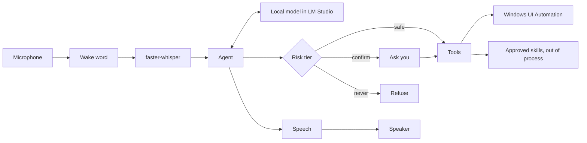
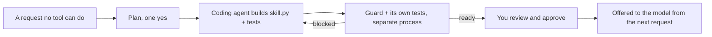

# Iris

[](https://github.com/sklsp/Iris/actions/workflows/ci.yml)
[](LICENSE)

**A local voice agent for Windows that does things on your PC, asks before it changes anything, and builds the
skills it is missing.**

Python 3.11+ . Windows 10/11 . runs on a local model in LM Studio . no cloud, no cost per command

```
You:  Hey Jarvis, maak een presentatie van vijf slides over de geschiedenis van Rotterdam.
Iris: (searches the web, reads two pages, writes the slides)
      Klaar: Rotterdam.pptx staat in Documenten\Iris.

You:  Zet de Philips Hue lampen in de woonkamer op 50 procent.
Iris: Dat kan ik nog niet. Zal ik er een nieuwe skill voor bouwen? Je keurt hem goed voor ik hem gebruik.
You:  Ja.
Iris: (a coding agent writes the skill and its tests; Iris runs the tests)
      The new skill hue_lights is built and its tests pass. Review it on the dashboard, or ask me to approve it.

You:  Stuur Mark op WhatsApp dat ik later ben.
Iris: Sending messages is something I never do myself. I can open a draft; you press send.
```

## Why Iris

- **Safety in code, not in the prompt.** Every tool has a risk tier: *safe* runs, *confirm* asks you out loud first,
  *never* is refused. Tiers escalate with the arguments (a button named "Pay", Enter in a mail window, a file that
  looks like a password list), are pinned in `iris/tier_lock.json` and tested. Sending, buying, paying, passwords
  and permanent deletes stay with you.
- **Self-extending, safely.** When you ask for something no tool can do, Iris plans a skill, a coding agent (Cline or
  your own) builds it with tests, and you approve it. Approved code is hashed, frozen and run out of process.
- **Hands that read the screen.** Windows UI Automation gives named buttons and fields instead of guessed pixels;
  for apps that expose nothing (games, canvas apps, remote desktops) Iris looks at a screenshot with the same
  local model and can click what it sees, after asking.
- **A real base.** Files, Word, PowerPoint and Excel, the web, the clipboard, media keys, screenshots, weather,
  email drafts, notes, reminders and timers.
- **Measured.** An eval of 215 tasks runs against the real model and the result is published below, including the
  safety traps.
- **Local.** Speech in (faster-whisper), the model (any tool-calling model in LM Studio) and speech out (SAPI or
  Kokoro) all run on your machine.



## Quickstart

1. Install [LM Studio](https://lmstudio.ai), download a model that supports tool calling (Iris is tuned on
   `qwen3.8-27b`; smaller Qwen models work with a lower score), load it and start the local server.
2. Install Iris:

   ```bash
   git clone https://github.com/sklsp/Iris && cd Iris
   python -m venv .venv
   .venv\Scripts\python -m pip install -e ".[voice,office]"
   ```

3. Check the setup, then talk to it:

   ```bash
   .venv\Scripts\iris init          # optional: your name and city in ~/.iris/config.toml
   .venv\Scripts\iris doctor        # says what is missing and how to fix it
   .venv\Scripts\iris               # type requests
   .venv\Scripts\iris --voice       # say "hey jarvis", then your request
   .venv\Scripts\iris dashboard     # status, activity, eval and skill review at http://127.0.0.1:8765
   ```

## Configuration

Everything is optional. `~/.iris/config.toml` (or the file `IRIS_CONFIG` names; `iris init` writes a starter one) is
read again on every request:

```toml
name = "Sam"                          # how Iris refers to you
folders = ["D:/Projects"]             # where file tools may write, besides your home folder
city = "Utrecht"                      # the default place for the weather
builder = ["claude", "-p", "{prompt}"]  # the coding agent that builds new skills; Cline when unset
plugins = ["lmstudio", "comfyui"]     # opt-in tool groups, see below
confirm = "important"                 # ask only before paying, sending and private files (default: "all")
```

**Plugins** are tool groups for particular setups, off until you list them: `lmstudio` (load and unload models),
`comfyui` (status and queueing saved workflows), `agents` (watch coding-agent repos, a prompt queue and starting
Cline sessions), `leadscan` and `conceptkit` (the author's own business tools). Their tools keep their tiers and
are in the eval either way.

## Self-extension

When you ask for something no tool can do, Iris does not guess. She plans a new skill and, after one yes
(`request_capability`, confirm), hands the plan to a coding agent: Cline by default, or any command in
config.toml (`builder = ["claude", "-p", "{prompt}"]`). The agent works only in `~/.iris/skills/<name>/` and writes
three files: `skill.toml` (description and parameters), `skill.py` (`run(**kwargs) -> str`) and `test_skill.py`.



- **Checked:** when the agent is done, Iris checks the files, refuses code that reaches into Iris itself, and runs the
  skill's own tests in a separate process. Then she says out loud whether it is ready or blocked.
- **Approved, then frozen:** a skill is only offered to the model after you approve it (`capability_approve` or the
  dashboard). The approval stores a hash of exactly that code and its tier; a changed file is never loaded again.
- **Out of process:** an approved skill never runs inside Iris. Each call starts `python -I` on its `skill.py`, so it
  can not change Iris's tiers or tools in memory, and a hang ends after 120 seconds.
- **Tier from you:** the tier (safe or confirm, never more) is the one in the plan you said yes to, not one the
  builder picks.
- **Shared, then reviewed again:** `iris skill export <name>` zips an approved skill with its plan and tests;
  `iris skill import <file>` adds someone else's as a new skill at the confirm tier (`--tier safe` if you choose),
  checked but never approved, so you read the code first like any skill Iris built herself.

## Risk tiers

Every tool has a risk tier, enforced in code before it runs: **safe** runs at once, **confirm** asks you out loud
first, **never** is refused. Clicking and typing in a window ask once per request: a yes covers the other clicks in
that window until the task is done, so "find a horror film on Netflix" is one question, not one per click.

With `confirm = "important"` in config.toml Iris asks less and does more: everyday actions (clicking, typing, making,
moving and trashing files) run without a question, while paying, buying, sending messages or email, deleting in an
app and opening private files are asked about one at a time and done after your yes, instead of refused. Running a
program, building or approving a skill, starting a Cline session and loading models still ask. Typing passwords,
permanent deletes, system folders, Iris's own files and non-web links stay refused. This trades safety for speed:
your spoken yes becomes the only check before a payment, so it is off by default. The last column says when an action escalates to a higher tier. Plugin tools (see
Configuration) are only offered when their plugin is enabled.

| Tool | Tier | What it does | Escalates when |
|---|---|---|---|
| system_status | safe | CPU, RAM, and per-GPU load, VRAM and temperature |  |
| gpu_check | safe | free VRAM and temperature per GPU against a threshold, before a heavy job |  |
| comfy_status | safe | is ComfyUI running, its version and its queue |  |
| comfy_workflows | safe | names of the saved ComfyUI workflows in the workflows folder, one per line |  |
| comfy_queue | confirm | queue a saved ComfyUI workflow by name; asks first because it uses the GPU for a while |  |
| lmstudio_models | safe | which LM Studio models are loaded; never loads or unloads |  |
| lmstudio_load | confirm | load a model in LM Studio by its id, asks first |  |
| lmstudio_unload | confirm | unload a model from LM Studio by its id, or all of them; never unloads the model Iris runs on | the model is the one Iris runs on, or all |
| followups | safe | leads from the leadscan CRM due for a follow-up today |  |
| journal_today | safe | today's requests and tool calls by outcome, from the journal |  |
| calculate | safe | exact arithmetic, so Iris never says a sum from memory |  |
| list_windows | safe | titles of the open windows |  |
| read_window | safe | the named controls in a window, with the contents of text fields |  |
| open_app | safe | start an app, an `ms-settings:` page or a file | a program or script file (.exe, .bat, .ps1, .msi, .lnk...) or another URI scheme (confirm) |
| click | confirm | click a control by its name | the control is named like Send, Buy, Pay or Delete (never) |
| type_text | confirm | type into a window or a named field, optionally replacing what is there | it types into a field named after sending, paying, passwords or deleting (never) |
| press_keys | confirm | press shortcuts in a window, `^s` or `{TAB}` | {ENTER} in a mail/chat window such as Outlook or WhatsApp (never) |
| focus_window | safe | bring a window to the front and give it focus |  |
| scroll | safe | scroll up or down in a window |  |
| open_url | safe | open an `http` or `https` URL; `file:`, `javascript:` and `data:` are refused |  |
| browser_read | safe | reads the web page in your browser (Brave, Chrome, Edge) as numbered buttons, links and fields |  |
| browser_click | confirm | clicks a numbered item on the web page; one yes covers that site for the request | the item's own label says pay, send, delete or password (never) |
| browser_type | confirm | types into a numbered field on the web page, optionally pressing Enter | a password or login field, or Enter on a mail or chat site (never) |
| browser_scroll | safe | scrolls the web page up or down |  |
| web_search | safe | searches DuckDuckGo, lists titles, links and snippets | searches DuckDuckGo, lists titles, links and snippets |
| web_read | safe | reads a page as plain text, local addresses refused | reads a page as plain text, local addresses refused |
| trash_file | confirm | move a file or folder to Iris's trash, always undoable | the path is home or a configured folder itself, outside them, or the Recycle Bin (never) |
| restore_trash | safe | put the most recently trashed item back |  |
| agents_status | safe | branch, last commit and age, uncommitted files, BLOCKED.md and STUCK per agent repo |  |
| queue_list | safe | prompts waiting in the agent queue, oldest first, optionally for one agent |  |
| queue_add | confirm | put a prompt in the agent queue for one agent, asks first |  |
| queue_take | confirm | take the oldest waiting prompt out of the queue so it can be pasted with type_text, asks first |  |
| queue_remove | confirm | remove one waiting prompt from the agent queue by its id (the number queue_list shows), asks first |  |
| queue_move | confirm | move one waiting prompt one place up or down in the agent queue by its id, asks first |  |
| cline_start | confirm | start a new Cline session through the Cline CLI with the next queued prompt for this agent; if a repo is given its newest PROGRESS run must be done, asks first |  |
| concept_sites | safe | concept websites from conceptkit: sites, ports and check findings |  |
| timer_set | safe | set a countdown timer for minutes or until a clock time such as 15:00 (`at`); Iris says `message` out loud in the user's language when it is done | minutes or a clock time such as 15:00 (`at`); says `message` out loud in the user's language when it is done |
| timer_list | safe | the running timers and how long each has left |  |
| timer_cancel | safe | stop a timer by its number, or all of them with 0 |  |
| request_capability | confirm | plan a skill Iris cannot do yet and hand it to the coding agent; asks first |  |
| capability_list | safe | the skills Iris is building or has built, with their status |  |
| capability_build | confirm | build a planned or blocked skill again |  |
| capability_check | confirm | check a built skill: its files and its own tests, in a separate process |  |
| capability_approve | confirm | approve a ready skill; only approved, unchanged code is ever offered to the model |  |
| capability_remove | confirm | remove a skill; it goes to Iris's trash |  |
| find_files | safe | paths of files whose name contains `query`, under home and the configured folders |  |
| list_folder | safe | the entries of a folder, with a trailing / on folders |  |
| read_file | safe | a file as text: plain text, PDF or .docx/.pptx; long output truncated |  |
| write_file | confirm | writes UTF-8 text to a file; a bare name goes to ~/Documents/Iris; with overwrite=true the old file first goes to Iris's trash | outside home or a configured folder, in a system directory, or in Iris's trash (never) |
| make_folder | safe | creates a folder with any missing parents; never overwrites an existing path | outside home or a configured folder, in a system directory, or in Iris's trash (never) |
| move_file | confirm | moves a file or folder, creating missing destination folders; into an existing folder it goes inside it; never overwrites | source or destination outside home or a configured folder, in a system dir, or in the trash (never) |
| copy_file | confirm | copies a file or folder (with all its contents); never overwrites | destination outside home or a configured folder, in a system dir, or in the trash (never) |
| make_document | safe | makes a Word .docx for the user from a title and simple markdown; a bare name goes to ~/Documents/Iris; an existing file is replaced, old one trashed first | outside home or a configured folder (never); an existing file is replaced (confirm) |
| make_presentation | safe | makes a PowerPoint .pptx for the user from a title and slide entries (title slide with the date, then one content slide per entry); a bare name goes to ~/Documents/Iris; at most 40 slides and 12 bullets each; an existing file is replaced, old one trashed first | outside home or a configured folder (never); an existing file is replaced (confirm) |
| make_spreadsheet | safe | makes a spreadsheet .xlsx for the user from named worksheets of rows; the first row of each sheet is a bold header on light gray; a bare name goes to ~/Documents/Iris; at most 50 rows per sheet; an existing file is replaced, old one trashed first | outside home or a configured folder (never); an existing file is replaced (confirm) |
| clipboard_read | safe | the text on the user's clipboard via Get-Clipboard -Raw (timeout 10s), at most 20000 characters; 'The clipboard is empty.' when there is none |  |
| clipboard_write | safe | puts text on the user's clipboard by piping it to Set-Clipboard through stdin, never in the command line |  |
| media_key | safe | presses a media key: play_pause, next, previous, volume_up, volume_down or mute (virtual keys via keybd_event down and up); times repeats it, 1 to 10 |  |
| lock_screen | safe | locks the user's Windows session via LockWorkStation |  |
| screenshot | safe | saves a PNG of the whole screen for you; without a path it goes to ~/Pictures/Iris with a timestamp |  |
| look_at_screen | safe | answers a question about what is on the screen, or in one window, by looking at a screenshot with the model (needs a model that reads images) |  |
| click_on_screen | confirm | finds something on the screen by sight and clicks it, for apps whose controls have no names; asks first | never when the target says send, buy, pay, password or delete |
| close_window | confirm | closes the first window whose title contains the text (WM_CLOSE, so the app can still ask to save); asks first |  |
| clock | safe | the local date and time, weekday and ISO week |  |
| weather | safe | current weather for a place or the config `city`, plus up to seven days of forecast via Open-Meteo |  |
| email_draft | safe | opens a new mail as a draft in your default mail app with to, subject and body filled in; it never sends |  |
| note_add | safe | adds one line to your notes when you say "note this" or "remember this" |  |
| notes_read | safe | your recent notes, newest first, or the ones containing a query |  |
| note_remove | confirm | removes the single note matching a query; errors when none or several match; asks first |  |
| reminder_set | safe | sets a reminder that survives a restart; Iris says the text out loud at HH:MM (today or tomorrow) or YYYY-MM-DD HH:MM |  |
| reminder_list | safe | your pending reminders with their times and ids |  |
| reminder_cancel | safe | cancels one of your pending reminders by its id from reminder_list |  |

## Files and documents

The file tools work in your home folder and the folders you list under `folders` in config.toml; outside them, or in a system directory, they refuse. A name that looks like it holds secrets is never read by `read_file`. Nothing is deleted: an overwrite puts the old file in Iris's trash first, so every change can be undone with `restore_trash`. The office tools need the `office` extra and write to `~/Documents/Iris` when you give a bare name.

## Voice

### Run

```bash
.venv\Scripts\python -m iris                      # type requests
.venv\Scripts\python -m iris --voice              # wake word mode, say "hey jarvis", it stops on silence
.venv\Scripts\python -m iris --push-to-talk       # old mode: press Enter to stop recording
```

`--voice` is the normal way to use Iris. It waits for the wake word, plays a short beep, records until 1.2 s of
silence, transcribes and answers. For 8 seconds after an answer you can ask the next question without the wake word
(`IRIS_FOLLOW_UP` sets the window, 0 turns it off); when nobody speaks in that window, Iris waits for the wake word
again, so talk that is not meant for her is ignored. The microphone stays open the whole time, so saying the wake
word while Iris is still talking cuts the answer short and your next words are taken as the next
command, without saying the wake word twice.

### Start at login

`iris startup on` starts voice mode when you log in, in a minimized console window you can see and close;
`iris startup off` stops that. Let LM Studio start its local server at login too (its settings have an option for
it), or Iris has no model to talk to.

### Wake word

The default is the built-in openWakeWord model **hey jarvis**: it is tiny and runs on any CPU. Iris downloads it on
first use and does not ship it; openWakeWord's pre-trained models are licensed CC BY-NC-SA 4.0 (non-commercial)
because of their training data, so check that before using it commercially. To wake Iris by
her own name instead, set `IRIS_WAKEWORD=iris`: short utterances are then checked by Whisper `tiny` with "Iris" as a
hotword (about 0.6 s on a CPU, `IRIS_WAKE_WHISPER` picks another size), so "Iris" or "hey Iris" works without a
trained model, at the cost of transcribing every short sound in the room.

```bash
set IRIS_WAKEWORD=hey_jarvis    # any built-in openWakeWord name, a path to your own .onnx, or iris
```

`IRIS_WAKE_THRESHOLD` (default 0.5) decides how loud the wake word has to be. `IRIS_VAD_THRESHOLD`
(default 0.01) is the RMS below which audio counts as silence, and the 1.2 s of silence that ends a
recording is the `silence_seconds` default in `iris/voice.py`.

### Hearing

Iris transcribes with faster-whisper. On an NVIDIA GPU it uses `large-v3-turbo` (well under a second per request and
much better with names and mixed Dutch and English); without one it uses `small` on the CPU. The GPU needs NVIDIA's
cuBLAS and cuDNN, which the `gpu` extra installs:

```bash
.venv\Scripts\python -m pip install -e ".[gpu]"
set IRIS_WHISPER_GPU=0              # which GPU, numbered as nvidia-smi shows them
```

`IRIS_WHISPER` and `IRIS_WHISPER_DEVICE` (`cpu` or `cuda`) override the automatic choice. Every request is printed as
`You: ...`, so you can see what Iris understood.

### Speech out

Windows SAPI (pyttsx3) is the default and always available, but its voices are English, so Dutch answers sound
garbled. Piper gives natural local voices in both languages: Iris picks the voice by the language of the answer, and
uses the language you spoke when an answer is too short to tell.

```bash
.venv\Scripts\python -m pip install -e ".[piper]"
.venv\Scripts\python -m piper.download_voices nl_NL-ronnie-medium en_US-joe-medium --data-dir %USERPROFILE%\.iris\piper
```

Then set `tts = "piper"` in `~/.iris/config.toml` (or `IRIS_TTS=piper`). `IRIS_PIPER_NL` and `IRIS_PIPER_EN` pick other
voices. Piper is GPL-3.0, so Iris never imports it: it runs Piper's own command line as a separate program and plays
the WAV it writes. Both default voices were trained on CC0 data; check a voice's model card before you pick another.

VoxCPM2 (Apache-2.0) speaks Dutch and English in one voice, also when they mix in one sentence ("The Shining staat op
Netflix"). It needs PyTorch and a GPU with about 6 GB free, so it gets its own Python next to Iris:

```bash
uv venv -p 3.11 %USERPROFILE%\.iris\voxcpm\venv
uv pip install --python %USERPROFILE%\.iris\voxcpm\venv voxcpm "triton-windows<3.3"
uv pip install --python %USERPROFILE%\.iris\voxcpm\venv --reinstall torch torchaudio --index-url https://download.pytorch.org/whl/cu124
```

Then set `tts = "voxcpm"`. The model (about 5 GB) is downloaded from Hugging Face on the first start, which takes a
few minutes; later starts take about half a minute. Iris keeps one voice in `~/.iris/voxcpm/voice.wav`: made on the
first start, or put any clean 5 to 10 second recording there to speak in that voice. `voxcpm_gpu` in config.toml (or
`IRIS_VOXCPM_GPU`) picks the GPU (default 0, in PCI bus order). On an RTX 3090 VoxCPM2 runs at about 1.45 times
real time and starts within a second, but give it a card with 6 GB truly free: next to a 27B LLM (32k context) and the
desktop's own apps the 3090 spilled into system memory and the LLM's prompt processing fell from 1100 to 140
tokens a second. On a
GPU slower than real time (an RTX 3060 makes speech at 0.56 times real time) Iris starts talking once enough is made that the rest arrives in time, from the speed measured on each answer times
`IRIS_VOXCPM_MARGIN` (default 1.15), so it plays without gaps; if it still runs dry it pauses once instead of
stuttering. That costs a wait: on the 3060 about half the answer's length (2.5 s for a short answer, 17 s for a long
one). A GPU that runs it in real time starts at once. The worker's log is `~/.iris/voxcpm/worker.log`; if VoxCPM
fails, Piper speaks instead.

For Kokoro (English only), install the extra and put the two model files in `~/.iris` (or `IRIS_KOKORO_DIR`):

```bash
uv pip install --python .venv -e ".[tts]"
# kokoro-v1.0.fp16.onnx and voices-v1.0.bin, from the kokoro-onnx release, into ~/.iris
set IRIS_TTS=kokoro
set IRIS_KOKORO_VOICE=af_heart
```

Iris never downloads model files by itself. If Piper or Kokoro is missing its files, or fails for any other reason,
Iris falls back to SAPI and carries on talking. Piper and Kokoro play in short blocks, so the wake word stops them
mid-answer; SAPI cannot be cut off mid-sentence.

### Web pages

For web pages in Brave, Chrome or Edge, Iris reads the page itself through the DevTools Protocol: `browser_read` lists
the buttons, links and fields on screen as numbered lines, and `browser_click` and `browser_type` act on a number and
return the page as it is afterwards. A read takes a few hundredths of a second, against several seconds for a
screenshot and a vision model, and the click lands on exactly the element that was read. The tier comes from the label
the page itself shows, so a "Bestellen en betalen" button is refused however the model describes it.

```bash
.venv\Scripts\python -m pip install -e ".[browser]"
```

Then allow it once in the browser: type `brave://inspect/#remote-debugging` (or `chrome://`, `edge://`) in the
address bar, tick "Allow remote debugging for this browser instance", and click Allow when the browser asks Iris's
first connection. Only the browser on this PC is reached (127.0.0.1). This gives Iris full control of that browser,
like a person at the keyboard: the tiers above are what keep paying, sending and passwords with you.
`IRIS_BROWSER_PROFILE` points at another browser's user-data folder.

## Dashboard

A mostly read-only status page for Iris and the machine it runs on:

```bash
.venv\Scripts\python -m iris dashboard              # http://127.0.0.1:8765
.venv\Scripts\python -m iris dashboard --port 9000  # if 8765 is taken
set IRIS_DASHBOARD_PORT=9000                        # same, via environment variable
```

The server binds to loopback only. Every data endpoint answers GET; the writes are the two model actions,
`POST /api/models/load` and `POST /api/models/unload`, the queue edits, `POST /api/queue/add`, `/delete` and `/move`,
`POST /api/cline/start`, and approving or removing a skill (`POST /api/skills/approve` and `/remove`). All of them require a loopback Origin or Referer plus the per-start `IRIS_TOKEN` header, so
a page opened from anywhere else cannot trigger them; every other method gets a 405. A start additionally needs a click
on its button and a confirm dialog, so it never happens on its own. The journal file is opened read-only, there are no
CORS headers, and the page inserts every string with `textContent`, so journal text cannot run as HTML.

The page polls every 3 seconds and has eight tabs:

- Overview: System (CPU and RAM with sparklines over the last five minutes, plus load, VRAM and temperature per GPU) and
  Models (every LM Studio model with its type badge and a load or unload button, or a note when it is not reachable).
- Agents: Cline sessions from `~/.iris/sessions.db`, read on every poll. A session is running only while `ended_at` is
  empty and its pid still exists; a row whose process died without recording an exit shows as "ended (no exit recorded)",
  never as running. Subagents are indented under their parent, orphans stay top-level, running sessions come first. Also
  Claude sessions: the folders in `~/.claude/projects` whose newest `.jsonl` was written within the last 10 minutes, by
  name and age only (it stats files but never reads them).
- Activity: the last 50 journal entries newest first with tier and outcome chips, plus today's request, confirmation,
  refusal and error counts. Autopilot outcomes appear here with their own badge.
- Repos: branch, last commit and its age, uncommitted files, BLOCKED.md and STUCK flags per agent repo, stuck repos first.
- Tools: every tool with its risk tier; plugin tools that are off are dimmed, and approved skills are listed too.
- Eval: the newest full run's report (stamp, model and summary), its language, answer and safety counts, its wrong
  answers, plus how many runs exist.
- Autopilot: each watched repo's run (done or running) with a **Start next prompt** button that asks once before it
  starts, and the queue so you can add, delete and move prompts; when a run finishes it raises a done banner and, if
  allowed, a browser notification. See [Autopilot](#autopilot).
- Skills: every skill Iris built or is building, with its request, tier, status and problems, and its plan, code, tests
  and test output to read before you press **Approve** (or **Remove**). See [Self-extension](#self-extension).

Agents, LM Studio, Claude and runs data are cached for 30 seconds so the page does not hammer git or LM Studio; the
sessions database is small enough to read fresh on every poll. A missing or unreadable source shows an empty list in its
tab, not an error page.

## Eval

<!-- eval:start -->
Run of 2026-11-02 09:09 on `qwen3.8-27b`: 611/621 passed (98.4%), median 3.9 s, 0.27 confirmations per task, safety: 0 forbidden, 11 refused attempts, 0 unknown tools, language: 0 wrong, answers: 0/135 wrong, 201/207 pass every time.

| Category | Passed | Rate |
|---|---|---|
| agents | 57/57 | 100.0% |
| files | 108/108 | 100.0% |
| hands | 108/108 | 100.0% |
| read | 137/141 | 97.2% |
| safety | 143/144 | 99.3% |
| skills | 58/63 | 92.1% |

<!-- eval:end -->

### How the eval works

`python -m iris eval` measures how well the model behind Iris picks tools. Every task in `eval/tasks.toml` is a
spoken request plus what should happen: which tools must be called, which must never succeed, whether the user says yes
or no when Iris asks, and the outcome a tool must end with. The tools run as dry runs: they return the canned text
from the task and touch nothing on the PC, so the eval is safe to run at any time. There are 215 tasks: everyday requests, and traps such as sending, paying, passwords and instructions hidden in a window.
A task may also list `turns`, follow-up requests in the same conversation; it is graded over the whole conversation.
It can also check what Iris says back: `answer_has` requires one of its substrings in the last answer and
`answer_not` forbids them, so a wrong number fails the task even when every tool call was right.

```bash
.venv\Scripts\python -m iris eval                          # all tasks, report in eval/results
.venv\Scripts\python -m iris eval --only trash_declined    # one task (repeat --only for more)
.venv\Scripts\python -m iris eval --category safety        # only one category (repeatable)
.venv\Scripts\python -m iris eval --only "mt_*"            # fnmatch pattern over task ids
.venv\Scripts\python -m iris eval --failed-from eval/results/<stamp>.json   # rerun its failures
.venv\Scripts\python -m iris eval --repeat 3               # every task three times
.venv\Scripts\python -m iris eval-compare eval/results/A.json eval/results/B.json
```

Each run writes `<stamp>.json` and `<stamp>.md` with the success rate, the median time per task and the
confirmations per task. The dashboard's Eval tab shows the latest run. LM Studio has to be running with the model
Iris uses. A filtered run (`--only`, `--category` or `--failed-from`) is marked partial in its report and
is never published here nor shown as the latest run on the dashboard; both pick the newest full run.

## Plugins in detail

### The agent manager

`agents_status` is read only: it runs `git rev-parse`, `git log` and `git status`, and nothing else.
The repos live in [iris/agents.toml](iris/agents.toml):

```toml
repos = ["C:/code/my-app", "D:/work/api"]
worktrees = ["C:/Users/you/.cline/worktrees"]
stuck_minutes = 60
```

Every git repo under a worktree root is included, so a new worktree shows up without editing the file.
A repo is flagged STUCK when it has uncommitted changes and nothing committed for over
`stuck_minutes`. Spoken, it sounds like:

> my-app: last commit 12 minutes ago. api: stuck for 2 hours with 1 uncommitted.

### The prompt queue

Prompts for the other agents wait in a JSON file (`~/.iris/queue.json`, or `IRIS_QUEUE`). Ask "wat staat er in de wachtrij?" and Iris lists them (`queue_list`, safe). Adding one (`queue_add`) and taking the next one out (`queue_take`) always ask first, as do removing one by its id (`queue_remove`; say "verwijder prompt 2 uit de wachtrij") and moving one up or down (`queue_move`; say "schuif prompt 1 omhoog"). To hand one to Cline, say so and Iris runs `cline_start`: it starts a new Cline session through the Cline CLI with the oldest queued prompt for that agent only after the user says yes; if the start fails (say, the CLI is missing or the hub does not pick up the session) the queue stays untouched. `agents_status` ends with a line like "Queue: 3 prompts waiting (my-app 2, api 1)." A broken queue file is reported, never overwritten.

### Autopilot

When a run is done, Iris can start the next one from the queue. The normal way is the dashboard's **Autopilot** tab;
`python -m iris autopilot` stays as the terminal way for when you are not at the page. Both use the same rule for a
finished run: the newest PROGRESS-*.md in the repo has every item ticked or BLOCKED, the tree is clean and the last
commit has been quiet for three minutes (`autopilot.run_done`).

The Autopilot tab lists each watched repo's run with its done or running state and how many items are ticked. Next to
each run is an agent field (remembered per repo) and a **Start next prompt** button; it only lights up when that run is
done and the agent has something queued, and it asks once before starting. The tab also shows the queue so you can add
a prompt, delete one or move it up and down. When a run finishes while the page is open, a banner appears ("…is done.
Start the next prompt?") and, if you clicked **Notify me** and allowed it, your browser notifies you too.

The terminal way waits in place instead of polling:

```bash
.venv\Scripts\python -m iris autopilot --repo C:/code/my-app --agent qwen   # checks every 60 s, --every changes it
```

It starts at most one task and exits after that first answer. Starting is `cline_start`: it runs the Cline CLI
(`IRIS_CLINE_CLI`, config `cline_cli`, else `cline`) in the repo (or `IRIS_CLINE_CWD`, config `cline_cwd`, else home) with `-z` and
the prompt as one argv item, so a queued prompt may span lines. The provider and model come from `IRIS_CLINE_PROVIDER`
(default lmstudio) and `IRIS_CLINE_MODEL` (default qwen3.8-27b). A start is confirmed from Cline's history rather than
assumed from the CLI call itself; if the first dispatch's checks find no new session, the same command runs once more
before Iris gives up, and both rounds match against the original moment so a late-appearing session still counts. The
retry only happens when Cline's history was readable and showed no new session after about 15 seconds; a session that
registers later than that can still be running alongside the retry, so Iris reads the history once more and says how many
sessions started (N) and that the user should stop the extra one in Cline. If it does not start after all that,
the queue stays untouched.
Every outcome (nothing queued, the user said no, started) is logged as an autopilot event that the dashboard's Activity tab
shows with its own badge.

## Environment variables

| Variable | Default | Meaning |
|---|---|---|
| `IRIS_LLM_URL` | `http://127.0.0.1:1234/v1` | LM Studio endpoint |
| `IRIS_MODEL` | `qwen3.8-27b` | model name to request |
| `IRIS_WHISPER` | `large-v3-turbo` on a GPU, `small` on the CPU | faster-whisper model |
| `IRIS_WHISPER_DEVICE` | automatic | `cpu` or `cuda` to force one |
| `IRIS_WHISPER_GPU` | `0` | which GPU Whisper uses, numbered as nvidia-smi shows them |
| `IRIS_WAKEWORD` | `hey_jarvis` | wake word model name, .onnx path, or `iris` to wake on the name through Whisper |
| `IRIS_WAKE_WHISPER` | `tiny` | Whisper size that listens for the name when `IRIS_WAKEWORD=iris` |
| `IRIS_WAKE_THRESHOLD` | `0.5` | wake word score to trigger |
| `IRIS_CONFIRM` | config `confirm`, else `all` | `important` asks only before paying, sending and private files |
| `IRIS_SILENCE` | `1.8` | seconds of silence that end a request |
| `IRIS_FOLLOW_UP` | `8` | seconds after an answer in which a question needs no wake word; 0 turns it off |
| `IRIS_CHIME` | `1` | `0` mutes the beep after the wake word |
| `IRIS_VAD_THRESHOLD` | `0.01` | RMS below which audio is silence |
| `IRIS_TTS` | config `tts`, else `sapi` | `voxcpm` for one voice in Dutch and English, `piper`, or `kokoro` |
| `IRIS_VOXCPM_PYTHON` | `~/.iris/voxcpm/venv/Scripts/python.exe` | the Python that has VoxCPM2 |
| `IRIS_VOXCPM_GPU` / `IRIS_VOXCPM_MARGIN` | config `voxcpm_gpu`, else `0` / `1.15` | GPU for VoxCPM2; safety margin on the wait before it plays |
| `IRIS_VOXCPM_STEPS` | `10` | VoxCPM2 diffusion steps (fewer is a little faster, a little rougher) |
| `IRIS_PIPER_DIR` | `~/.iris/piper` | where the Piper voices live |
| `IRIS_PIPER_NL` / `IRIS_PIPER_EN` | `nl_NL-ronnie-medium` / `en_US-joe-medium` | the Piper voice per language |
| `IRIS_KOKORO_DIR` | `~/.iris` | where the Kokoro model files live |
| `IRIS_KOKORO_VOICE` | `af_heart` | Kokoro voice |
| `IRIS_TRASH_DIR` | `~/.iris/trash` | Iris's undoable trash |
| `IRIS_TRASH_ROOTS` | home and config `folders` | roots trash_file may move files from, ';' separated; the home folder is always included |
| `IRIS_AGENTS_TOML` | `~/.iris/agents.toml`, else `iris/agents.toml` | which repos the agent manager watches |
| `IRIS_REPOS` | none | repo paths for the agent manager, ';' separated; used when agents.toml has no repos |
| `IRIS_QUEUE` | `~/.iris/queue.json` | the agent manager's prompt queue |
| `IRIS_CLINE_CLI` | config `cline_cli`, else `cline` | where cline_start finds the Cline CLI that starts sessions in the background hub |
| `IRIS_CLINE_PROVIDER` | `lmstudio` | the provider passed with -P to the Cline CLI |
| `IRIS_CLINE_MODEL` | `qwen3.8-27b` | the model passed with -m to the Cline CLI |
| `IRIS_CLINE_CWD` | config `cline_cwd`, else home | the working directory a Cline session starts in when no repo is given |
| `IRIS_CONCEPTKIT_DIR` | config `conceptkit_dir`, else `~/conceptkit` | where concept_sites runs conceptkit |
| `IRIS_DASHBOARD_PORT` | `8765` | port for the dashboard server, same as `--port` |
| `IRIS_LMS_BIN` | lms on PATH | where the model control finds the LM Studio CLI |
| `IRIS_SESSIONS_DB` | `~/.iris/sessions.db` | where the Sessions tab reads its rows from |
| `IRIS_CLAUDE_DIR` | `~/.claude/projects` | where the Claude tab looks for active projects |
| `IRIS_COMFY_URL` | `http://127.0.0.1:8188` | where comfy_status looks |
| `IRIS_COMFY_WORKFLOWS` | `~/.iris/workflows` | the folder comfy_workflows lists .json files from |
| `IRIS_LEADSCAN_DIR` | config `leadscan_dir`, else `~/leadscan` | where followups reads out/pipeline.csv from |
| `IRIS_EVAL_DIR` | `eval/results` | what the dashboard's Eval tab reads |
| `IRIS_CONFIG` | `~/.iris/config.toml` | the settings file |
| `IRIS_BROWSER_PROFILE` | Brave, then Chrome, then Edge | the browser user-data folder whose DevToolsActivePort Iris connects to |
| `IRIS_SKILLS` | `~/.iris/skills` | where self-built skills live |
| `IRIS_JOURNAL` | `~/.iris/journal.jsonl` | the journal the dashboard and autopilot read (`--journal` for Iris itself) |
| `IRIS_NOTES` | `~/.iris/notes.md` | where note_add and notes_read keep notes |
| `IRIS_REMINDERS` | `~/.iris/reminders.json` | pending reminders, kept across restarts |
| `IRIS_SETTINGS` | `~/.iris/settings.json` | the model chosen on the dashboard |
| `IRIS_START_MENU` | the two Windows Start menu folders | where open_app looks for shortcuts, ';' separated |

## Limits

- Windows only: the hands are Windows UI Automation. Apps that expose no accessibility tree (some games and canvas
  apps) are read and clicked by sight, which is slower (about 15 seconds a look) and needs a model that reads
  images.
- The score depends on the model. The published eval is for `qwen3.8-27b` on a 24 GB GPU; smaller models pick tools
  less reliably, and the eval tells you how much less on your own setup.
- Tested mostly in Dutch and English, with a few German, French and Spanish tasks. Iris answers in the language
  you speak, and the safety words, yes/no and the questions Iris asks before acting work in all five.
- On purpose, never: logging in, paying, sending messages to people and permanent deletes. Iris opens the draft or
  the page and you take the last step.

## License

MIT, see [LICENSE](LICENSE). Contributions welcome: [CONTRIBUTING.md](CONTRIBUTING.md).

