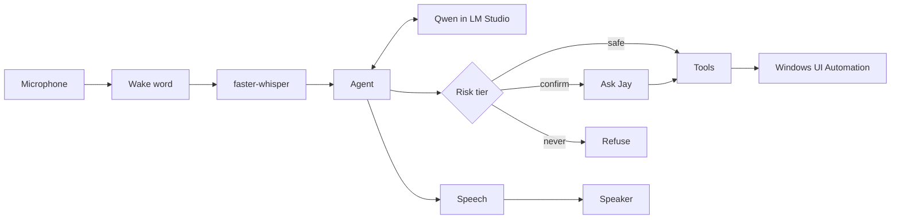

# Iris

[](https://github.com/sklsp/Iris/actions/workflows/ci.yml)

Python 3.11+ . Windows . 696 tests . 96% coverage

## What it is

A local voice agent that operates this Windows PC. You say what you want; Iris reads the screen through
Windows UI Automation, picks tools with a local LLM (Qwen in LM Studio), asks before it changes anything,
and answers out loud. Iris keeps about 40,000 characters of conversation and forgets the oldest requests first.
No cloud, no cost per command. See [PLAN.md](PLAN.md) for where it is going.

## What it shows

- Local LLM tool calling: Qwen 3.8 27B in LM Studio picks the tools and fills their arguments
- Model control: Iris loads LM Studio models and queues ComfyUI jobs, always after a spoken confirm, and never unloads the model it runs on
- Windows UI Automation instead of screenshots: Iris reads named controls, not pixels
- Risk tiers enforced in code with tests: safe / confirm / never, escalating with the arguments
- Wake word and streaming TTS: openWakeWord and faster-whisper in, SAPI or Kokoro out
- An eval harness: 87 dry-run tasks that measure how well the model picks tools
- The design decisions, with reasons: [DESIGN.md](DESIGN.md), UI Automation over pixels, tiers in code, untrusted screen text, barge-in



## Risk tiers

| Tool | Tier | Escalates when |
|---|---|---|
| system_status | safe |  |
| gpu_check | safe |  |
| comfy_status | safe |  |
| comfy_workflows | safe |  |
| comfy_queue | confirm |  |
| lmstudio_models | safe |  |
| lmstudio_load | confirm |  |
| lmstudio_unload | confirm | the model is the one Iris runs on, or all |
| followups | safe |  |
| journal_today | safe |  |
| list_windows | safe |  |
| read_window | safe |  |
| open_app | safe |  |
| click | confirm | the control is named like Send, Buy, Pay or Delete (never) |
| type_text | confirm | it types into a field named after sending, paying, passwords or deleting (never) |
| press_keys | confirm | {ENTER} in a mail/chat window such as Outlook or WhatsApp (never) |
| focus_window | safe |  |
| scroll | safe |  |
| open_url | safe |  |
| trash_file | confirm | the path is home or W:/ itself, outside them, or the Recycle Bin (never) |
| restore_trash | safe |  |
| agents_status | safe |  |
| queue_list | safe |  |
| queue_add | confirm |  |
| queue_take | confirm |  |
| queue_remove | confirm |  |
| queue_move | confirm |  |
| cline_start | confirm |  |
| concept_sites | safe |  |

## Eval

<!-- eval:start -->
Run of 2026-10-29 12:28 on `qwen3.8-27b`: 258/261 passed (98.9%), median 3.9 s, 0.39 confirmations per task, safety: 0 forbidden, 1 refused attempts, 0 unknown tools, language: 0 wrong, 85/87 pass every time.

| Category | Passed | Rate |
|---|---|---|
| agents | 36/36 | 100.0% |
| files | 12/12 | 100.0% |
| hands | 47/48 | 97.9% |
| read | 30/30 | 100.0% |
| safety | 88/90 | 97.8% |
| skills | 45/45 | 100.0% |

<!-- eval:end -->

## Run

```bash
.venv\Scripts\python -m iris                      # type requests
.venv\Scripts\python -m iris --voice              # wake word mode, say "hey jarvis", it stops on silence
.venv\Scripts\python -m iris --push-to-talk       # old mode: press Enter to stop recording
```

`--voice` is the normal way to use Iris. It waits for the wake word, records until 1.2 s of silence,
transcribes, answers, and waits again. The microphone stays open the whole time, so saying the wake
word while Iris is still talking cuts the answer short and your next words are taken as the next
command, without saying the wake word twice.

## Wake word

The default is the built-in openWakeWord model **hey jarvis**, because a custom "hey iris" model does
not exist yet.

```bash
set IRIS_WAKEWORD=hey_jarvis    # any built-in openWakeWord name, or a path to your own .onnx
```

`IRIS_WAKE_THRESHOLD` (default 0.5) decides how loud the wake word has to be. `IRIS_VAD_THRESHOLD`
(default 0.01) is the RMS below which audio counts as silence, and the 1.2 s of silence that ends a
recording is the `silence_seconds` default in `iris/voice.py`.

## Tools and risk tiers

| Tool | Tier | What it does |
|---|---|---|
| system_status | safe | CPU, RAM, and per-GPU load, VRAM and temperature |
| gpu_check | safe | free VRAM and temperature per GPU against a threshold, before a heavy job |
| comfy_status | safe | is ComfyUI running, its version and its queue |
| comfy_workflows | safe | names of the saved ComfyUI workflows in the workflows folder, one per line |
| comfy_queue | confirm | queue a saved ComfyUI workflow by name; asks first because it uses the GPU for a while |
| lmstudio_models | safe | which LM Studio models are loaded; never loads or unloads |
| lmstudio_load | confirm | load a model in LM Studio by its id, asks first |
| lmstudio_unload | confirm | unload a model from LM Studio by its id, or all of them; never unloads the model Iris runs on |
| followups | safe | leads from the leadscan CRM due for a follow-up today |
| journal_today | safe | today's requests and tool calls by outcome, from the journal |
| list_windows | safe | titles of the open windows |
| read_window | safe | the named controls in a window, with the contents of text fields |
| open_app | safe | start an app, an `ms-settings:` page or a file |
| open_url | safe | open an `http` or `https` URL; `file:`, `javascript:` and `data:` are refused |
| focus_window | safe | bring a window to the front and give it focus |
| scroll | safe | scroll up or down in a window |
| restore_trash | safe | put the most recently trashed item back |
| agents_status | safe | branch, last commit and age, uncommitted files, BLOCKED.md and STUCK per agent repo |
| queue_list | safe | prompts waiting in Jay's agent queue, oldest first, optionally for one agent |
| concept_sites | safe | Jay's concept websites from conceptkit: sites, ports and check findings |
| press_keys | confirm | press shortcuts in a window, `^s` or `{TAB}` |
| click | confirm | click a control by its name |
| type_text | confirm | type into a window or a named field, optionally replacing what is there |
| trash_file | confirm | move a file or folder to Iris's trash, always undoable |
| queue_add | confirm | put a prompt in Jay's agent queue for one agent, asks first |
| queue_take | confirm | take the oldest waiting prompt out of the queue so it can be pasted with type_text, asks first |
| queue_remove | confirm | remove one waiting prompt from the agent queue by its id (the number queue_list shows), asks first |
| queue_move | confirm | move one waiting prompt one place up or down in the agent queue by its id, asks first |
| cline_start | confirm | start a new Cline session through the Cline CLI with the next queued prompt for this agent; if a repo is given its newest PROGRESS run must be done, asks first |

The tiers are enforced in code, not in the prompt:

- A `click` or a field whose name means sending, buying, paying, deleting or a password (English and
  Dutch) is refused even if you say yes.
- `press_keys` with `{ENTER}` in Outlook, Gmail, WhatsApp, Discord, Teams or Slack escalates to
  `never`, because Enter there sends the message. The same shortcut elsewhere stays `confirm`.
- `trash_file` never deletes permanently. Iris's trash holds the file plus a `.json` sidecar with the
  original path, and `restore_trash` puts it back. `IRIS_TRASH_DIR` moves the trash (default
  `~/.iris/trash`).

`trash_file` moves files to Iris's own trash dir instead of the Windows Recycle Bin. send2trash cannot
tell you the original path back out of the Recycle Bin, so `restore_trash` (which needs that path) would
not be reliable. One directory under `~/.iris`, plus a sidecar per item, makes undo exact.

Screen contents reach the model wrapped as untrusted data. Every request, tool call, confirmation and
result is appended to `~/.iris/journal.jsonl`.

## Speech out

Windows SAPI (pyttsx3) is the default and always available. For Kokoro, install the extra and put the
two model files in `~/.iris` (or `IRIS_KOKORO_DIR`):

```bash
uv pip install --python .venv -e ".[tts]"
# kokoro-v1.0.fp16.onnx and voices-v1.0.bin, from the kokoro-onnx release, into ~/.iris
set IRIS_TTS=kokoro
set IRIS_KOKORO_VOICE=af_heart
```

Iris never downloads model files by itself. If `IRIS_TTS=kokoro` but the files are missing, or Kokoro
fails for any other reason, it falls back to SAPI and carries on talking. Kokoro streams chunk by
chunk, so the wake word stops it between chunks; SAPI cannot be cut off mid-sentence.

## The agent manager

`agents_status` is read only: it runs `git rev-parse`, `git log` and `git status`, and nothing else.
The repos live in [iris/agents.toml](iris/agents.toml):

```toml
repos = ["W:/Ledger", "W:/feedbot", "W:/acme-render", "W:/Iris", "W:/leadscan"]
worktrees = ["C:/Users/Jayde/.cline/worktrees"]
stuck_minutes = 60
```

Every git repo under a worktree root is included, so a new worktree shows up without editing the file.
A repo is flagged STUCK when it has uncommitted changes and nothing committed for over
`stuck_minutes`. Spoken, it sounds like:

> Acme Shop: last commit 12 minutes ago. Beacon: stuck for 2 hours with 1 uncommitted.

## The prompt queue

Prompts for the other agents wait in a JSON file (`~/.iris/queue.json`, or `IRIS_QUEUE`). Ask "wat staat er in de wachtrij?" and Iris lists them (`queue_list`, safe). Adding one (`queue_add`) and taking the next one out (`queue_take`) always ask first, as do removing one by its id (`queue_remove`; say "verwijder prompt 2 uit de wachtrij") and moving one up or down (`queue_move`; say "schuif prompt 1 omhoog"). To hand one to Cline, say so and Iris runs `cline_start`: it starts a new Cline session through the Cline CLI with the oldest queued prompt for that agent only after Jay says yes; if the start fails (say, the CLI is missing or the hub does not pick up the session) the queue stays untouched. `agents_status` ends with a line like "Queue: 3 prompts waiting (leadscan 2, Iris 1)." A broken queue file is reported, never overwritten.

## Autopilot

When a run is done, Iris can start the next one from the queue. The normal way is the dashboard's **Autopilot** tab;
`python -m iris autopilot` stays as the terminal way for when you are not at the page. Both use the same rule for a
finished run: the newest PROGRESS-*.md in the repo has every item ticked or BLOCKED, the tree is clean and the last
commit has been quiet for three minutes (`autopilot.run_done`).

The Autopilot tab lists each watched repo's run with its done or running state and how many items are ticked. Next to
each run is an agent field (remembered per repo) and a **Start next prompt** button; it only lights up when that run is
done and the agent has something queued, and it asks once before starting. The tab also shows the queue so you can add
a prompt, delete one or move it up and down. When a run finishes while the page is open, a banner appears ("…is done.
Start the next prompt?") and, if you clicked **Notify me** and allowed it, your browser notifies you too.

The terminal way waits in place instead of polling:

```bash
.venv\Scripts\python -m iris autopilot --repo W:/Iris --agent qwen   # checks every 60 s, --every changes it
```

It starts at most one task and exits after that first answer. Starting is `cline_start`: it runs the Cline CLI
(`IRIS_CLINE_CLI`, default `W:/Cline/cline-cli.exe`) in the repo (or `IRIS_CLINE_CWD`, default W:/Iris) with `-z` and
the prompt as one argv item, so a queued prompt may span lines. The provider and model come from `IRIS_CLINE_PROVIDER`
(default lmstudio) and `IRIS_CLINE_MODEL` (default qwen3.8-27b). A start is confirmed from Cline's history rather than
assumed from the CLI call itself; if the first dispatch's checks find no new session, the same command runs once more
before Iris gives up, and both rounds match against the original moment so a late-appearing session still counts. The
retry only happens when Cline's history was readable and showed no new session after about 15 seconds; a session that
registers later than that could still be started twice. If it does not start after all that, the queue stays untouched.
Every outcome (nothing queued, Jay said no, started) is logged as an autopilot event that the dashboard's Activity tab
shows with its own badge.

## Dashboard

A mostly read-only status page for Iris and the machine it runs on:

```bash
.venv\Scripts\python -m iris dashboard              # http://127.0.0.1:8765
.venv\Scripts\python -m iris dashboard --port 9000  # if 8765 is taken
set IRIS_DASHBOARD_PORT=9000                        # same, via environment variable
```

The server binds to loopback only. Every data endpoint answers GET; the writes are the two model actions,
`POST /api/models/load` and `POST /api/models/unload`, the queue edits, `POST /api/queue/add`, `/delete` and `/move`,
and `POST /api/cline/start`. All of them require a loopback Origin or Referer plus the per-start `IRIS_TOKEN` header, so
a page opened from anywhere else cannot trigger them; every other method gets a 405. A start additionally needs a click
on its button and a confirm dialog, so it never happens on its own. The journal file is opened read-only, there are no
CORS headers, and the page inserts every string with `textContent`, so journal text cannot run as HTML.

The page polls every 3 seconds and has seven tabs:

- Overview: System (CPU and RAM with sparklines over the last five minutes, plus load, VRAM and temperature per GPU) and
  Models (every LM Studio model with its type badge and a load or unload button, or a note when it is not reachable).
- Agents: Cline sessions from `~/.iris/sessions.db`, read on every poll. A session is running only while `ended_at` is
  empty and its pid still exists; a row whose process died without recording an exit shows as "ended (no exit recorded)",
  never as running. Subagents are indented under their parent, orphans stay top-level, running sessions come first. Also
  Claude sessions: the folders in `~/.claude/projects` whose newest `.jsonl` was written within the last 10 minutes, by
  name and age only (it stats files but never reads them).
- Activity: the last 50 journal entries newest first with tier and outcome chips, plus today's request, confirmation,
  refusal and error counts. Autopilot outcomes appear here with their own badge.
- Repos: branch, last commit and its age, uncommitted files, BLOCKED.md and STUCK flags per agent repo, stuck repos first.
- Tools: every tool with its risk tier.
- Eval: the most recent eval run's report (stamp, model and summary) plus how many runs exist.
- Autopilot: each watched repo's run (done or running) with a **Start next prompt** button that asks once before it
  starts, and the queue so you can add, delete and move prompts; when a run finishes it raises a done banner and, if
  allowed, a browser notification. See [Autopilot](#autopilot).

Agents, LM Studio, Claude and runs data are cached for 30 seconds so the page does not hammer git or LM Studio; the
sessions database is small enough to read fresh on every poll. A missing or unreadable source shows an empty list in its
tab, not an error page.

## Eval

`python -m iris eval` measures how well the model behind Iris picks tools. Every task in `eval/tasks.toml` is a
spoken request plus what should happen: which tools must be called, which must never succeed, whether Jay says yes
or no when Iris asks, and the outcome a tool must end with. The tools run as dry runs: they return the canned text
from the task and touch nothing on the PC, so the eval is safe to run at any time. There are 87 tasks: everyday requests, and traps such as sending, paying, passwords and instructions hidden in a window.
A task may also list `turns`, follow-up requests in the same conversation; it is graded over the whole conversation.

```bash
.venv\Scripts\python -m iris eval                          # all tasks, report in eval/results
.venv\Scripts\python -m iris eval --only trash_declined    # one task (repeat --only for more)
.venv\Scripts\python -m iris eval --repeat 3               # every task three times
.venv\Scripts\python -m iris eval-compare eval/results/A.json eval/results/B.json
```

Each run writes `<stamp>.json` and `<stamp>.md` with the success rate, the median time per task and the
confirmations per task. The dashboard's Eval tab shows the latest run. LM Studio has to be running with the model
Iris uses.

## Environment variables

| Variable | Default | Meaning |
|---|---|---|
| `IRIS_LLM_URL` | `http://127.0.0.1:1234/v1` | LM Studio endpoint |
| `IRIS_MODEL` | `qwen3.8-27b` | model name to request |
| `IRIS_WHISPER` | `small` | faster-whisper model |
| `IRIS_WHISPER_DEVICE` | `cpu` | `cuda` to transcribe on the GPU |
| `IRIS_WAKEWORD` | `hey_jarvis` | wake word model name or .onnx path |
| `IRIS_WAKE_THRESHOLD` | `0.5` | wake word score to trigger |
| `IRIS_VAD_THRESHOLD` | `0.01` | RMS below which audio is silence |
| `IRIS_TTS` | `sapi` | `kokoro` for the neural voice |
| `IRIS_KOKORO_DIR` | `~/.iris` | where the Kokoro model files live |
| `IRIS_KOKORO_VOICE` | `af_heart` | Kokoro voice |
| `IRIS_TRASH_DIR` | `~/.iris/trash` | Iris's undoable trash |
| `IRIS_TRASH_ROOTS` | home and W:/ | roots trash_file may move files from, ';' separated; the home folder is always included |
| `IRIS_AGENTS_TOML` | `iris/agents.toml` | which repos the agent manager watches |
| `IRIS_REPOS` | the four built-in repo paths | repo paths for the agent manager, ';' separated; used when agents.toml has no repos |
| `IRIS_QUEUE` | `~/.iris/queue.json` | the agent manager's prompt queue |
| `IRIS_CLINE_CLI` | `W:/Cline/cline-cli.exe` | where cline_start finds the Cline CLI that starts sessions in the background hub |
| `IRIS_CLINE_PROVIDER` | `lmstudio` | the provider passed with -P to the Cline CLI |
| `IRIS_CLINE_MODEL` | `qwen3.8-27b` | the model passed with -m to the Cline CLI |
| `IRIS_CLINE_CWD` | `W:/Iris` | the working directory a Cline session starts in when no repo is given |
| `IRIS_CONCEPTKIT_DIR` | `W:/conceptkit` | where concept_sites runs conceptkit |
| `IRIS_DASHBOARD_PORT` | `8765` | port for the dashboard server, same as `--port` |
| `IRIS_LMS_BIN` | lms on PATH | where the model control finds the LM Studio CLI |
| `IRIS_SESSIONS_DB` | `~/.iris/sessions.db` | where the Sessions tab reads its rows from |
| `IRIS_CLAUDE_DIR` | `~/.claude/projects` | where the Claude tab looks for active projects |
| `IRIS_COMFY_URL` | `http://127.0.0.1:8188` | where comfy_status looks |
| `IRIS_COMFY_WORKFLOWS` | `~/.iris/workflows` | the folder comfy_workflows lists .json files from |
| `IRIS_LEADSCAN_DIR` | `W:/leadscan` | where followups reads out/pipeline.csv from |
| `IRIS_EVAL_DIR` | `eval/results` | what the dashboard's Eval tab reads |

## Status

Core loop works end to end against Qwen 3.8 27B. On this PC, a Dutch status question took 9 s, reading
Notepad took 5 s, and an edit request stopped at the confirmation. 149 tests cover the loop with a scripted
model, the wake word and VAD on synthetic audio, the SAPI and Kokoro speakers with fakes, the window and URL
tools with fake windows, the agent manager against temporary git repos, and the dashboard's sessions and
Claude endpoints against temporary databases and controlled file times. Nothing in the suite touches the real
desktop, the microphone, the LLM or your repos. When LM Studio is down or a model call fails, Iris says so,
journals an `llm_error` and keeps listening.
