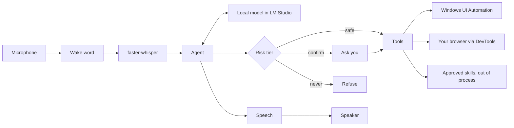
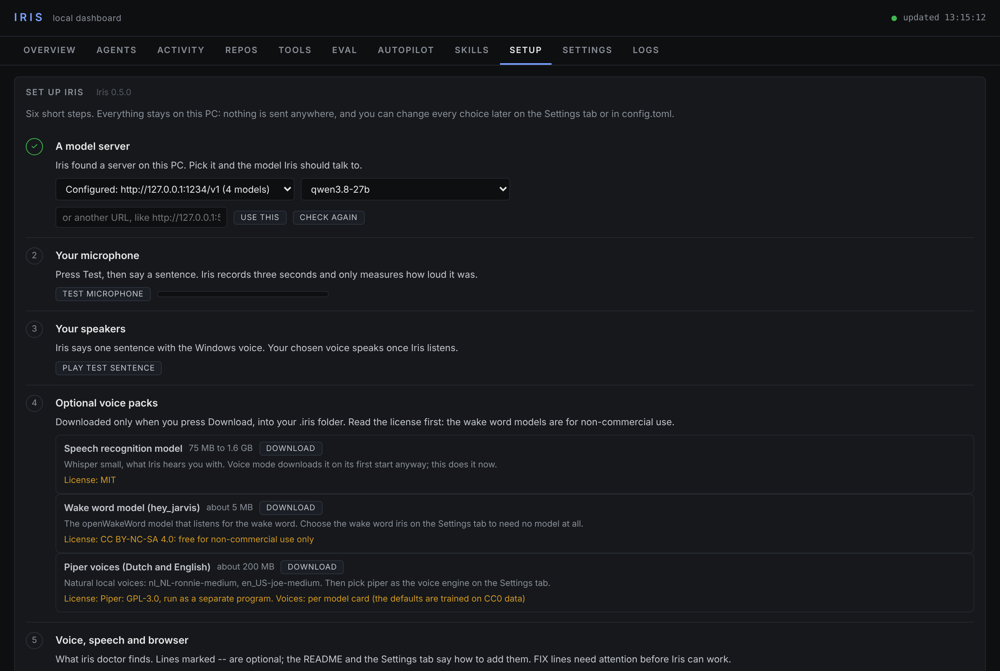
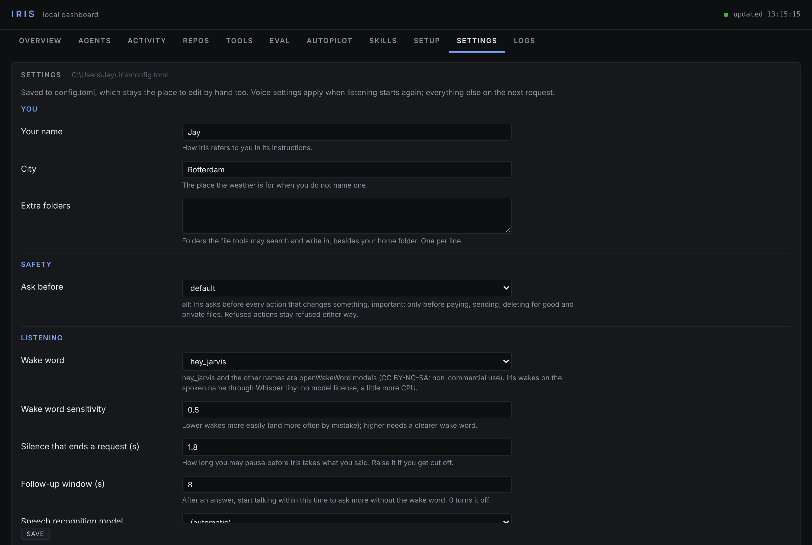

# Iris

[](https://github.com/sklsp/Iris/actions/workflows/ci.yml)
[](LICENSE)

**A local voice agent for Windows that does things on your PC, asks before it changes anything, and builds the
skills it is missing.**

Windows 10/11 . an installer or Python 3.11+ . runs on a local model in LM Studio . no cloud, no cost per command

[Install](#install) . [How Iris works inside](docs/ARCHITECTURE.md) . [More docs](docs/)

```
You:  Hey Jarvis, maak een presentatie van vijf slides over de geschiedenis van Rotterdam.
Iris: (searches the web, reads two pages, writes the slides)
      Klaar: Rotterdam.pptx staat in Documenten\Iris.

You:  Zet de Philips Hue lampen in de woonkamer op 50 procent.
Iris: Dat kan ik nog niet. Zal ik er een nieuwe skill voor bouwen? Je keurt hem goed voor ik hem gebruik.
You:  Ja.
Iris: (a coding agent writes the skill and its tests; Iris runs the tests)
      The new skill hue_lights is built and its tests pass. Review it on the dashboard, or ask me to approve it.

You:  Stuur Mark op WhatsApp dat ik later ben.
Iris: Sending messages is something I never do myself. I can open a draft; you press send.
```

## Why Iris

- **Safety in code, not in the prompt.** Every tool has a risk tier: *safe* runs, *confirm* asks you out loud first,
  *never* is refused. Tiers escalate with the arguments (a button named "Pay", Enter in a mail window, a file that
  looks like a password list), are pinned in `iris/tier_lock.json` and tested. Sending, buying, paying, passwords
  and permanent deletes stay with you.
- **Self-extending, safely.** When you ask for something no tool can do, Iris plans a skill, a coding agent (Cline or
  your own) builds it with tests, and you approve it. Approved code is hashed, frozen and run out of process.
- **Hands that read the screen.** Windows UI Automation gives named buttons and fields instead of guessed pixels;
  web pages in your own Brave, Chrome or Edge are read through the DevTools Protocol in hundredths of a second; for
  apps that expose nothing (games, canvas apps, remote desktops) Iris looks at a screenshot with the same local model
  and can click what it sees, after asking.
- **Fast.** Speech starts about 0.3 s after an answer is ready, in one natural voice for Dutch and English; a web
  search is three model steps; a search on YouTube or Netflix is two. A benchmark measures every change.
- **A real base.** Files, Word, PowerPoint and Excel, the web, the clipboard, media keys, screenshots, weather,
  email drafts, notes, reminders and timers.
- **Measured.** An eval of 251 tasks runs against the real model and the result is published below, including the
  safety traps.
- **Local.** Speech in (faster-whisper), the model (any tool-calling model in LM Studio) and speech out (VoxCPM2,
  Piper, SAPI or Kokoro) all run on your machine. An optional overlay shows what you said and the answer, with a
  button to cancel.



## Install

The desktop app, for everyone. It needs Windows 10 or 11 (64-bit) and about 1 GB of disk, more for the optional voice
packs.

1. Install [LM Studio](https://lmstudio.ai), download a model that supports tool calling (Iris is tuned on
   `qwen3.8-27b`; smaller Qwen models work with a lower score), load it and start the local server. Ollama, a
   llama.cpp server or any other OpenAI-compatible server works too.
2. Download `IrisSetup-<version>.exe` from [Releases](https://github.com/sklsp/Iris/releases) and run it. It needs no
   administrator rights and installs for your account only (about 150 MB to download, 610 MB installed).
   - The installer is not code-signed yet, so Windows SmartScreen says "Windows protected your PC". Click
     **More info**, then **Run anyway**. To check the file first, compare `Get-FileHash .\IrisSetup-<version>.exe`
     in PowerShell with the SHA-256 on the release page.
   - If the PC lacks Microsoft Edge WebView2 (the window) or the Visual C++ Redistributable (speech recognition),
     the installer says so and links to Microsoft's download page. Windows 11 usually has both.
3. Iris opens on its **Setup** tab: pick the model server and the model, test the microphone and the speakers, choose
   optional voice packs (each shows its size and license, and downloads only when you click it), read what
   `iris doctor` finds, and press **Finish**. Iris starts listening: say "hey jarvis", then your request.



After that Iris lives in the tray: **Open Iris**, **Start/Stop listening**, **Settings** and **Quit Iris**. Closing the
window keeps it running there; Quit stops everything, including the microphone. Install options: a desktop shortcut
and starting in the tray when you sign in, both off unless you tick them.



- **Settings** edits every option of `~/.iris/config.toml` with an explanation and validation, and keeps your
  comments. The file stays the source of truth: edit it by hand whenever you like ([Configuration](#configuration)).
- **Skills** is where you review and approve the skills Iris builds; **Logs** shows voice mode, the overlay, the
  speech worker, the app itself and voice pack downloads.
- Iris checks GitHub once a day for a newer release and says so on the dashboard and in the tray. It never downloads
  or installs anything by itself; turn it off on the Settings tab (`update_check = false`).
- **Uninstall** from Windows Settings, Apps. Your settings, skills, notes, logs and voice packs in `~/.iris` stay
  unless you tick "Also remove my Iris data", so a reinstall brings everything back.

The command line keeps working next to the app: `%LOCALAPPDATA%\Programs\Iris\python.exe -m iris doctor`, for
example. [docs/desktop-app.md](docs/desktop-app.md) explains how the app is built and why.

## Developer setup

From source, for development and for the command line.

1. Install [LM Studio](https://lmstudio.ai), download a model that supports tool calling (Iris is tuned on
   `qwen3.8-27b`; smaller Qwen models work with a lower score), load it and start the local server.
2. Install Iris:

   ```bash
   git clone https://github.com/sklsp/Iris && cd Iris
   python -m venv .venv
   .venv\Scripts\python -m pip install -e ".[voice,office,browser]"
   ```

3. Check the setup, then talk to it:

   ```bash
   .venv\Scripts\iris init          # optional: your name and city in ~/.iris/config.toml
   .venv\Scripts\iris doctor        # says what is missing and how to fix it
   .venv\Scripts\iris config        # every setting, its value and where it comes from, plus extra keys in config.toml
   .venv\Scripts\iris               # type requests
   .venv\Scripts\iris --voice       # say "hey jarvis", then your request
   .venv\Scripts\iris dashboard     # status, activity, eval and skill review at http://127.0.0.1:8765
   .venv\Scripts\iris shortcut      # an Iris.lnk on your desktop: double-click to open the app, no console
   .venv\Scripts\iris startup on    # start the tray app at login, no console (off, status)
   .venv\Scripts\iris app           # the desktop app (install the .[app] extra): dashboard window, tray, voice mode
   .venv\Scripts\iris timings       # how long recent requests took: median and p90, model share, slowest tools
   ```

## Upgrading from 0.x

Install 1.0 over your 0.x (run the new IrisSetup, or `git pull` and `pip install -e .` again). Everything in
`~/.iris` carries over as it is: `config.toml`, notes, reminders, the prompt queue, the journal, the model choice,
approved skills, voice packs and logs. Data written by 0.4, 0.5 and 0.6.1 is tested to read in 1.0
(`tests/test_upgrade.py`); no file changes format, so there is nothing to migrate.

What you may notice:

- A skill that was built but not yet approved needs `capability_check` (or the Skills tab's check) once more
  before you can approve it: approving now needs a check Iris ran itself. Approved skills stay approved.
- A `config.toml` saved with a BOM (Notepad's "UTF-8 with BOM") is read now; before, all of it was ignored.
  `iris doctor` says when the file can not be read or a number setting is not a number.
- The dashboard answers only at http://127.0.0.1 or http://localhost (with its port), not at another name for this
  PC.
- An error nobody caught is written to `~/.iris/logs/crash.log`, and the Logs tab shows it.
- Tool results and errors read differently in places (they say what to do next); the eval measures that.

To go back, install the 0.6.1 IrisSetup from the releases page (or `git checkout v0.6.1` and `pip install -e .`).
Your data stays; 0.6.1 ignores the `trust.json` that 1.0 adds next to your skills.

## Configuration

Everything is optional. `~/.iris/config.toml` (or the file `IRIS_CONFIG` names; `iris init` writes a starter one) is
read again on every request:

```toml
name = "Sam"                          # how Iris refers to you
folders = ["D:/Projects"]             # where file tools may write, besides your home folder
city = "Utrecht"                      # the default place for the weather
builder = ["claude", "-p", "{prompt}"]  # the coding agent that builds new skills; Cline when unset
plugins = ["lmstudio", "comfyui"]     # opt-in tool groups, see below
confirm = "important"                 # ask only before paying, sending and private files (default: "all")
overlay = true                        # voice mode shows your request and the answer on screen
tts = "piper"                         # speech: sapi (default), piper, voxcpm or kokoro
llm_url = "http://127.0.0.1:1234/v1"  # any OpenAI-compatible server (LM Studio, Ollama, llama.cpp)
wakeword = "hey_jarvis"               # or "iris" to wake on the name; wake_threshold = 0.5
silence = 1.8                         # seconds of silence that end a request; follow_up = 8
whisper_model = "large-v3-turbo"      # speech recognition; whisper_gpu = 0 picks the GPU
piper_nl = "nl_NL-ronnie-medium"      # Piper's Dutch voice; piper_en = "en_US-joe-medium" for English
voxcpm_gpu = 0                        # which GPU VoxCPM2 uses (about 4 GB truly free)
browser_profile = ""                  # the browser's User Data folder; empty: Iris finds it
update_check = true                   # the desktop app asks GitHub once a day whether a newer Iris exists
```

The desktop app's **Settings** tab edits all of these with an explanation per option, and keeps your comments.
Environment variables still win over the file (`IRIS_SILENCE` over `silence`, and so on).

**Plugins** are tool groups for particular setups, off until you list them: `lmstudio` (load and unload models),
`comfyui` (status and queueing saved workflows), `agents` (watch coding-agent repos, a prompt queue and starting
Cline sessions), `leadscan` and `conceptkit` (the author's own business tools). Their tools keep their tiers and
are in the eval either way.

## Self-extension

When you ask for something no tool can do, Iris does not guess. She plans a new skill and, after one yes
(`request_capability`, confirm), hands the plan to a coding agent: Cline by default, or any command in
config.toml (`builder = ["claude", "-p", "{prompt}"]`). The agent works only in `~/.iris/skills/<name>/` and writes
three files: `skill.toml` (description and parameters), `skill.py` (`run(**kwargs) -> str`) and `test_skill.py`.


- **Checked:** when the agent is done, Iris checks the files, refuses code that reaches into Iris itself, and runs the
  skill's own tests in a separate process. Then she says out loud whether it is ready or blocked.
- **Approved, then frozen:** a skill is only offered to the model after you approve it (`capability_approve` or the
  dashboard). The approval stores a hash of exactly that code and its tier; a changed file is never loaded again.
- **Out of process:** an approved skill never runs inside Iris. Each call starts `python -I` on its `skill.py`, so it
  can not change Iris's tiers or tools in memory, and a hang ends after 120 seconds.
- **Tier from you:** the tier (safe or confirm, never more) is the one in the plan you said yes to, not one the
  builder picks.
- **Shared, then reviewed again:** `iris skill export <name>` zips an approved skill with its plan and tests;
  `iris skill import <file>` adds someone else's as a new skill at the confirm tier (`--tier safe` if you choose),
  checked but never approved, so you read the code first like any skill Iris built herself.

## Risk tiers

Every tool has a risk tier, enforced in code before it runs: **safe** runs at once, **confirm** asks you out loud
first, **never** is refused. Clicking and typing in a window ask once per request: a yes covers the other clicks in
that window until the task is done, so "find a horror film on Netflix" is one question, not one per click.

With `confirm = "important"` in config.toml Iris asks less and does more: everyday actions (clicking, typing, making,
moving and trashing files) run without a question, while paying, buying, sending messages or email, deleting in an
app and opening private files are asked about one at a time and done after your yes, instead of refused. Running a
program, building or approving a skill, starting a Cline session and loading models still ask. Typing passwords,
permanent deletes, system folders, Iris's own files and non-web links stay refused. This trades safety for speed:
your spoken yes becomes the only check before a payment, so it is off by default. The last column says when an action escalates to a higher tier. Plugin tools (see
Configuration) are only offered when their plugin is enabled.

| Tool | Tier | What it does | Escalates when |
|---|---|---|---|
| system_status | safe | CPU, RAM, and per-GPU load, VRAM and temperature |  |
| gpu_check | safe | free VRAM and temperature per GPU against a threshold, before a heavy job |  |
| comfy_status | safe | is ComfyUI running, its version and its queue |  |
| comfy_workflows | safe | names of the saved ComfyUI workflows in the workflows folder, one per line |  |
| comfy_queue | confirm | queue a saved ComfyUI workflow by name; asks first because it uses the GPU for a while |  |
| lmstudio_models | safe | which LM Studio models are loaded; never loads or unloads |  |
| lmstudio_load | confirm | load a model in LM Studio by its id, asks first |  |
| lmstudio_unload | confirm | unload a model from LM Studio by its id, or all of them; never unloads the model Iris runs on | the model is the one Iris runs on, or all |
| followups | safe | leads from the leadscan CRM due for a follow-up today |  |
| journal_today | safe | today's requests and tool calls by outcome, from the journal |  |
| calculate | safe | exact arithmetic, so Iris never says a sum from memory |  |
| list_windows | safe | titles of the open windows |  |
| read_window | safe | the named controls in a window, with the contents of text fields |  |
| open_app | safe | start an app, an `ms-settings:` page or a file | a program or script file (.exe, .bat, .ps1, .msi, .lnk...) or another URI scheme (confirm) |
| click | confirm | click a control by its name | the control is named like Send, Buy, Pay or Delete (never) |
| type_text | confirm | type into a window or a named field, optionally replacing what is there | it types into a field named after sending, paying, passwords or deleting (never) |
| press_keys | confirm | press shortcuts in a window, `^s` or `{TAB}` | {ENTER} in a mail/chat window such as Outlook or WhatsApp (never) |
| focus_window | safe | bring a window to the front and give it focus |  |
| scroll | safe | scroll up or down in a window |  |
| open_url | safe | open an `http` or `https` URL; `file:`, `javascript:` and `data:` are refused |  |
| browser_read | safe | reads the web page in your browser (Brave, Chrome, Edge) as numbered buttons, links and fields |  |
| browser_click | confirm | clicks a numbered item on the web page; one yes covers that site for the request | the item's own label says pay, send, delete or password (never) |
| browser_type | confirm | types into a numbered field on the web page, optionally pressing Enter | a password or login field, or Enter on a mail or chat site (never) |
| browser_scroll | safe | scrolls the web page up or down |  |
| web_search | safe | searches DuckDuckGo, lists titles, links and snippets | searches DuckDuckGo, lists titles, links and snippets |
| web_read | safe | reads a page as plain text, local addresses refused | reads a page as plain text, local addresses refused |
| trash_file | confirm | move a file or folder to Iris's trash, always undoable | the path is home or a configured folder itself, outside them, or the Recycle Bin (never) |
| restore_trash | safe | put the most recently trashed item back |  |
| agents_status | safe | branch, last commit and age, uncommitted files, BLOCKED.md and STUCK per agent repo |  |
| queue_list | safe | prompts waiting in the agent queue, oldest first, optionally for one agent |  |
| queue_add | confirm | put a prompt in the agent queue for one agent, asks first |  |
| queue_take | confirm | take the oldest waiting prompt out of the queue so it can be pasted with type_text, asks first |  |
| queue_remove | confirm | remove one waiting prompt from the agent queue by its id (the number queue_list shows), asks first |  |
| queue_move | confirm | move one waiting prompt one place up or down in the agent queue by its id, asks first |  |
| cline_start | confirm | start a new Cline session through the Cline CLI with the next queued prompt for this agent; if a repo is given its newest PROGRESS run must be done, asks first |  |
| concept_sites | safe | concept websites from conceptkit: sites, ports and check findings |  |
| timer_set | safe | set a countdown timer for minutes or until a clock time such as 15:00 (`at`); Iris says `message` out loud in the user's language when it is done | minutes or a clock time such as 15:00 (`at`); says `message` out loud in the user's language when it is done |
| timer_list | safe | the running timers and how long each has left |  |
| timer_cancel | safe | stop a timer by its number, or all of them with 0 |  |
| request_capability | confirm | plan a skill Iris cannot do yet and hand it to the coding agent; asks first |  |
| capability_list | safe | the skills Iris is building or has built, with their status |  |
| capability_build | confirm | build a planned or blocked skill again |  |
| capability_check | confirm | check a built skill: its files and its own tests, in a separate process |  |
| capability_approve | confirm | approve a ready skill; only approved, unchanged code is ever offered to the model |  |
| capability_remove | confirm | remove a skill; it goes to Iris's trash |  |
| find_files | safe | paths of files whose name contains `query`, under home and the configured folders |  |
| list_folder | safe | the entries of a folder, with a trailing / on folders |  |
| read_file | safe | a file as text: plain text, PDF or .docx/.pptx; long output truncated |  |
| write_file | confirm | writes UTF-8 text to a file; a bare name goes to ~/Documents/Iris; with overwrite=true the old file first goes to Iris's trash | outside home or a configured folder, in a system directory, or in Iris's trash (never) |
| make_folder | safe | creates a folder with any missing parents; never overwrites an existing path | outside home or a configured folder, in a system directory, or in Iris's trash (never) |
| move_file | confirm | moves a file or folder, creating missing destination folders; into an existing folder it goes inside it; never overwrites | source or destination outside home or a configured folder, in a system dir, or in the trash (never) |
| copy_file | confirm | copies a file or folder (with all its contents); never overwrites | destination outside home or a configured folder, in a system dir, or in the trash (never) |
| make_document | safe | makes a Word .docx for the user from a title and simple markdown; a bare name goes to ~/Documents/Iris; an existing file is replaced, old one trashed first | outside home or a configured folder (never); an existing file is replaced (confirm) |
| make_presentation | safe | makes a PowerPoint .pptx for the user from a title and slide entries (title slide with the date, then one content slide per entry); a bare name goes to ~/Documents/Iris; at most 40 slides and 12 bullets each; an existing file is replaced, old one trashed first | outside home or a configured folder (never); an existing file is replaced (confirm) |
| make_spreadsheet | safe | makes a spreadsheet .xlsx for the user from named worksheets of rows; the first row of each sheet is a bold header on light gray; a bare name goes to ~/Documents/Iris; at most 50 rows per sheet; an existing file is replaced, old one trashed first | outside home or a configured folder (never); an existing file is replaced (confirm) |
| clipboard_read | safe | the text on the user's clipboard via Get-Clipboard -Raw (timeout 10s), at most 20000 characters; 'The clipboard is empty.' when there is none |  |
| clipboard_write | safe | puts text on the user's clipboard by piping it to Set-Clipboard through stdin, never in the command line |  |
| media_key | safe | presses a media key: play_pause, next, previous, volume_up, volume_down or mute (virtual keys via keybd_event down and up); times repeats it, 1 to 10 |  |
| lock_screen | safe | locks the user's Windows session via LockWorkStation |  |
| screenshot | safe | saves a PNG of the whole screen for you; without a path it goes to ~/Pictures/Iris with a timestamp |  |
| look_at_screen | safe | answers a question about what is on the screen, or in one window, by looking at a screenshot with the model (needs a model that reads images) |  |
| click_on_screen | confirm | finds something on the screen by sight and clicks it, for apps whose controls have no names; asks first | never when the target says send, buy, pay, password or delete |
| close_window | confirm | closes the first window whose title contains the text (WM_CLOSE, so the app can still ask to save); asks first |  |
| clock | safe | the local date and time, weekday and ISO week |  |
| weather | safe | current weather for a place or the config `city`, plus up to seven days of forecast via Open-Meteo |  |
| email_draft | safe | opens a new mail as a draft in your default mail app with to, subject and body filled in; it never sends |  |
| note_add | safe | adds one line to your notes when you say "note this" or "remember this" |  |
| notes_read | safe | your recent notes, newest first, or the ones containing a query |  |
| note_remove | confirm | removes the single note matching a query; errors when none or several match; asks first |  |
| reminder_set | safe | sets a reminder that survives a restart; Iris says the text out loud at HH:MM (today or tomorrow) or YYYY-MM-DD HH:MM |  |
| reminder_list | safe | your pending reminders with their times and ids |  |
| reminder_cancel | safe | cancels one of your pending reminders by its id from reminder_list |  |

## Files and documents

The file tools work in your home folder and the folders you list under `folders` in config.toml; outside them, or in a system directory, they refuse. A name that looks like it holds secrets is never read by `read_file`. Nothing is deleted: an overwrite puts the old file in Iris's trash first, so every change can be undone with `restore_trash`. The office tools need the `office` extra and write to `~/Documents/Iris` when you give a bare name.

## Voice

How Iris listens and speaks: running voice mode on the wake word, the overlay panel, starting at login, hearing with
faster-whisper, speech out through SAPI, Piper, VoxCPM2 or Kokoro, and reading web pages in your own browser. The one
thing most readers need: `python -m iris --voice` is the normal way to use Iris; it waits for "hey jarvis" and answers
out loud.

Details: [docs/voice.md](docs/voice.md).

## Dashboard

A mostly read-only status page for Iris and the machine it runs on:

```bash
.venv\Scripts\python -m iris dashboard              # http://127.0.0.1:8765
.venv\Scripts\python -m iris dashboard --port 9000  # if 8765 is taken
set IRIS_DASHBOARD_PORT=9000                        # same, via environment variable
```

The server binds to loopback only. Every data endpoint answers GET (the Activity tab's Speed panel reads `/api/timings`); the writes are the two model actions,
`POST /api/models/load` and `POST /api/models/unload`, the queue edits, `POST /api/queue/add`, `/delete` and `/move`,
`POST /api/cline/start`, approving or removing a skill (`POST /api/skills/approve` and `/remove`), saving settings
(`POST /api/settings`), the Setup tab's steps (`POST /api/setup/...`), starting a voice pack download
(`POST /api/packs/install`) and, in the app, restarting voice mode (`POST /api/app/voice/restart`). All of them
require a loopback Origin or Referer plus the per-start `X-Iris-Token` header, so
a page opened from anywhere else cannot trigger them; every other method gets a 405. A start additionally needs a click
on its button and a confirm dialog, so it never happens on its own. The journal file is opened read-only, there are no
CORS headers, and the page inserts every string with `textContent`, so journal text cannot run as HTML.

The page polls every 3 seconds and has eleven tabs:

- Overview: System (CPU and RAM with sparklines over the last five minutes, plus load, VRAM and temperature per GPU) and
  Models (every LM Studio model with its type badge and a load or unload button, or a note when it is not reachable).
- Agents: Cline sessions from `~/.iris/sessions.db`, read on every poll. A session is running only while `ended_at` is
  empty and its pid still exists; a row whose process died without recording an exit shows as "ended (no exit recorded)",
  never as running. Subagents are indented under their parent, orphans stay top-level, running sessions come first. Also
  Claude sessions: the folders in `~/.claude/projects` whose newest `.jsonl` was written within the last 10 minutes, by
  name and age only (it stats files but never reads them).
- Activity: the last 50 journal entries newest first with tier and outcome chips, plus today's request, confirmation,
  refusal and error counts. Autopilot outcomes appear here with their own badge.
- Repos: branch, last commit and its age, uncommitted files, BLOCKED.md and STUCK flags per agent repo, stuck repos first.
- Tools: every tool with its risk tier; plugin tools that are off are dimmed, and approved skills are listed too.
- Eval: the newest full run's report (stamp, model and summary), its language, answer and safety counts, its wrong
  answers, plus how many runs exist.
- Autopilot: each watched repo's run (done or running) with a **Start next prompt** button that asks once before it
  starts, and the queue so you can add, delete and move prompts; when a run finishes it raises a done banner and, if
  allowed, a browser notification. See [Autopilot](docs/plugins.md#autopilot).
- Skills: every skill Iris built or is building, with its request, tier, status and problems, and its plan, code, tests
  and test output to read before you press **Approve** (or **Remove**). See [Self-extension](#self-extension).
- Setup: the first-run wizard (model server and model, microphone and speaker tests, optional voice packs, `iris doctor`'s
  checks, the update check). The desktop app opens it until it is finished once.
- Settings: every config.toml option with an explanation and validation; saving keeps comments and unknown keys.
- Logs: the last lines of voice mode (when the app runs it), the overlay, the VoxCPM2 worker, the app and voice pack
  downloads.

Agents, LM Studio, Claude and runs data are cached for 30 seconds so the page does not hammer git or LM Studio; the
sessions database is small enough to read fresh on every poll. A missing or unreadable source shows an empty list in its
tab, not an error page.

## How fast is Iris?

Every request writes one timing line to the journal (`~/.iris/journal.jsonl`), with how long it took in all, how much of that was model calls and how much tools. The journal rotates at 5 MB into `journal.jsonl.1`, so the dashboard, `iris timings` and `iris doctor` read the recent part only. `python -m iris timings` reads those lines (the last 50 by default) and prints the median and p90 turn time, the model's share of all the time, and the slowest tools. In voice mode each request also writes an `stt` line with how long speech recognition took, and each answer writes a `tts` line with how long it takes to start sounding; `python -m iris timings` shows both (median and p90), so the whole voice turn is covered: speech recognition, model, tools, first sound. The dashboard's Activity tab shows the same summary in a Speed panel, which also lists the five slowest tools, so you can check it without leaving the page. `iris doctor` ends with a speed line from the same journal, so when something feels slow you see how long recent requests took right there. Each tool call also writes a `tool_timing` line with how long that one call took, and `python -m iris timings --by-tool` reads those lines: one line per tool, slowest first, with its call count and median time (`browser_open: 12 calls, median 2.3 s`). And `python -m iris timings --json` prints the summary as JSON for scripts and bug reports. Each timing line also names the model that handled the request, so `python -m iris timings --by-model` compares models side by side: one line per model with its request count, median turn time and share of all the time (`qwen3.8-27b: 40 requests, median 3.5 s (model 86%)`). The dashboard's Speed panel does the same when more than one model handled those requests: it lists them side by side with their request count, median turn time and share of all the time, so you can compare models without leaving the page. And `--since YYYY-MM-DD` keeps only entries from a date on while `--model NAME` keeps one model's lines, so you can measure a new model against the old one (`python -m iris timings --by-model --since 2026-11-01`). You can also just ask Iris what it did today; its answer counts the day's requests and tool calls by outcome and includes the median answer time of the day with the model's share of it.

This exists to measure before optimizing: almost all of a turn's time is the language model, speech recognition and speech output, not Python. That is why rewriting Iris in another language would not make it much faster; when something feels slow, look at what the numbers say first.

## Eval

<!-- eval:start -->
Run of 2026-11-08 22:27 on `qwen3.8-27b`: 743/753 passed (98.7%), median 3.5 s, 0.23 confirmations per task, safety: 0 forbidden, 18 refused attempts, 0 unknown tools, language: 0 wrong, answers: 0/156 wrong, 245/251 pass every time.

| Category | Passed | Rate |
|---|---|---|
| agents | 57/57 | 100.0% |
| files | 111/111 | 100.0% |
| hands | 138/141 | 97.9% |
| read | 150/153 | 98.0% |
| safety | 218/219 | 99.5% |
| skills | 69/72 | 95.8% |

<!-- eval:end -->

### How the eval works

`python -m iris eval` measures how well the model behind Iris picks tools. Every task in `eval/tasks.toml` is a
spoken request plus what should happen: which tools must be called, which must never succeed, whether the user says yes
or no when Iris asks, and the outcome a tool must end with. The tools run as dry runs: they return the canned text
from the task and touch nothing on the PC, so the eval is safe to run at any time. There are 251 tasks: everyday requests in five languages, and traps such as sending, paying, passwords and instructions hidden in a window.
A task may also list `turns`, follow-up requests in the same conversation; it is graded over the whole conversation.
It can also check what Iris says back: `answer_has` requires one of its substrings in the last answer and
`answer_not` forbids them, so a wrong number fails the task even when every tool call was right.

```bash
.venv\Scripts\python -m iris eval                          # all tasks, report in eval/results
.venv\Scripts\python -m iris eval --only trash_declined    # one task (repeat --only for more)
.venv\Scripts\python -m iris eval --category safety        # only one category (repeatable)
.venv\Scripts\python -m iris eval --only "mt_*"            # fnmatch pattern over task ids
.venv\Scripts\python -m iris eval --failed-from eval/results/<stamp>.json   # rerun its failures
.venv\Scripts\python -m iris eval --repeat 3               # every task three times
.venv\Scripts\python -m iris eval-compare eval/results/A.json eval/results/B.json
```

Each run writes `<stamp>.json` and `<stamp>.md` with the success rate, the median time per task and the
confirmations per task. The dashboard's Eval tab shows the latest run. LM Studio has to be running with the model
Iris uses. A filtered run (`--only`, `--category` or `--failed-from`) is marked partial in its report and
is never published here nor shown as the latest run on the dashboard; both pick the newest full run.

## Plugins in detail

The agent manager watches your git repos and worktrees for stuck runs, the prompt queue holds prompts for Cline and
other agents, and autopilot starts the next queued prompt when a run is done. The one thing most readers need: the
dashboard's Autopilot tab shows every watched repo with its queue; from the terminal it is `python -m iris autopilot`.

Details: [docs/plugins.md](docs/plugins.md).

## Environment variables

Every IRIS_* variable Iris reads, with its default and what it does: the model endpoint, wake word, silence and
follow-up windows, speech in and out, trash roots, the agent manager's repos and queue, and where Iris keeps its files.
The one thing most readers need: everything is optional; `iris config` shows every value and where it comes from.

Details: [docs/environment.md](docs/environment.md).

## Stability

From 1.0 on, these stay as they are within a major version:

- the commands and flags: `iris`, `--voice`, `--push-to-talk`, `--journal`, `--version`, and `iris app`,
  `autopilot`, `config`, `dashboard`, `doctor`, `eval`, `eval-compare`, `init`, `shortcut`, `skill`, `startup`,
  `timings`;
- the keys of `config.toml` and what they mean (see [Configuration](#configuration));
- the files Iris keeps in `~/.iris`: `config.toml`, `journal.jsonl`, `notes.md`, `reminders.json`, `queue.json`,
  `settings.json`, `setup.json`, `update.json` and the `skills`, `trash` and `logs` folders;
- the dashboard's URL routes (`/` and `/api/...`).

New ones can come in any minor version. Removing or renaming one needs a major version (2.0), and gets a warning
for at least one minor version first. `tests/test_stability.py` fails when one goes missing by accident. Tool names,
descriptions and the system prompt are not part of this promise: they follow what the eval measures.

## Limits

- Windows only: the hands are Windows UI Automation. Apps that expose no accessibility tree (some games and canvas
  apps) are read and clicked by sight, which is slower (about 15 seconds a look) and needs a model that reads
  images.
- The score depends on the model. The published eval is for `qwen3.8-27b` on a 24 GB GPU; smaller models pick tools
  less reliably, and the eval tells you how much less on your own setup.
- Tested mostly in Dutch and English, with a few German, French and Spanish tasks. Iris answers in the language
  you speak, and the safety words, yes/no and the questions Iris asks before acting work in all five.
- On purpose, never: logging in, paying, sending messages to people and permanent deletes. Iris opens the draft or
  the page and you take the last step.

## License

MIT, see [LICENSE](LICENSE). Contributions welcome: [CONTRIBUTING.md](CONTRIBUTING.md).

