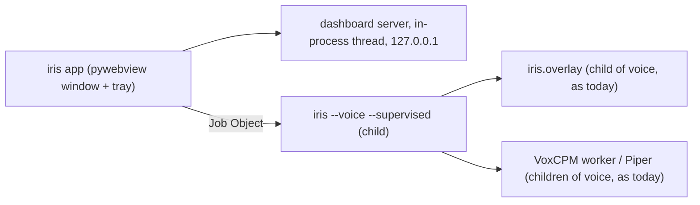

# Iris as a desktop app: architecture decision

Status: **approved** on 2026-11-03, as recommended (see Decisions at the end).

Goal: people install Iris like LM Studio. They download one installer, find Iris in the Start menu, and get an app
window with a dashboard and settings, a tray icon and a first-run setup, instead of a terminal plus a localhost
page. The CLI (`iris`, `iris --voice`, `iris dashboard`, ...) keeps working unchanged for developers.

## 1. App shell: pywebview on Edge WebView2, tray through WinForms

**Decision:** a native window from [pywebview](https://pywebview.flowrl.com) (BSD-3, 6.2.1 at the time of writing)
that shows the existing dashboard, plus a tray icon. New command: `iris app`.

| Option | Extra size | Extra toolchain | Reuses the Python core and dashboard | Verdict |
|---|---|---|---|---|
| **pywebview on WebView2** | about 1.2 MB (pywebview, pythonnet, bottle, clr_loader, cffi, proxy_tools; all MIT or BSD) | none | yes, as is | **chosen** |
| Tauri | about 5 MB shell | Rust in CI and for contributors | the dashboard yes, Python as a sidecar process | a second language for a thin window |
| Electron | about 150 MB | Node | the dashboard yes, Python as a sidecar process | doubles the download for the same window |
| PySide6 / Qt WebEngine | about 200 MB | none | dashboard in WebEngine | LGPL, heavy |
| Tk (already used by the overlay) | 0 | none | no, the UI would be rewritten | not worth a rewrite |

Why pywebview: the dashboard (`iris/dashboard/`) is already the UI, so the window is a frame around it. WebView2 is
the Edge engine that ships with Windows 11 and comes with Edge on Windows 10; the installer checks for it and links
to Microsoft's download page when it is missing (we do not bundle it).

**Tray icon:** pywebview's Windows backend loads .NET WinForms through pythonnet, so the tray is a WinForms
`NotifyIcon` with a context menu on its own STA thread: no extra dependency. Menu: Start/Stop listening, Open,
Settings, Quit. Fallback if it fights pywebview's GUI thread: pystray (LGPL-3.0, one more dependency, needs approval).

**Focus rule:** the app window only comes forward on a user action (Start menu, tray click, a second launch). Status
changes and notifications use the tray balloon, which never takes focus. The overlay keeps its no-activate window
styles. Iris types into the window that was active before, never into its own.

## 2. Running as one app

- **One instance:** a named mutex `Local\Iris-App` (ctypes). A second launch finds the first window and brings it
  forward, then exits. Inno Setup's `AppMutex` uses the same name to close the app before an upgrade or uninstall.
- **Dashboard:** `make_server()` on its usual port (8765 or `IRIS_DASHBOARD_PORT`), falling back to a free port when
  that one is taken, in a daemon thread of the app. The page token and Origin check stay as they are; the window
  loads `http://127.0.0.1:<port>/`.
- **Voice loop:** the app starts `python -m iris --voice --supervised` as one child process inside a Windows Job
  Object with kill-on-close. `--supervised` only adds a thread that waits on a named stop event (its name comes in
  `IRIS_STOP_EVENT`) and then quits the way Ctrl+C does, so the normal shutdown path runs (the session closes the
  mic, the overlay and the VoxCPM worker). Not stdin: a thread blocked reading a pipe makes every DLL that checks
  stdin while it loads (numpy's does) wait for that read, which hung the voice loop at start. The child gets no
  stdin at all. The overlay and speech workers stay children of the voice loop, exactly as in the CLI.
- **Start/Stop listening** starts or stops that child. Stopping frees the microphone and the GPU memory. A restart
  takes as long as the voice stack takes to load (about half a minute with VoxCPM2).
- **Clean shutdown:** Quit sets the stop event, waits up to 5 seconds, then terminates the job. If the app
  itself crashes, the job closes with it and Windows ends every child, so no orphan holds 6 GB of VRAM.
- **Crash handling:** if the voice child exits on its own, the tray says so with the last log lines; no automatic
  restart loop.
- **Voice already running in a terminal:** `iris --voice` takes a named mutex `Local\Iris-Voice` but never refuses
  to start; the app checks it and says "voice mode is already running in a terminal" instead of starting a second
  loop on the same microphone.
- **Logs:** the child's stdout and stderr go to `~/.iris/logs/voice.log` (moved to `voice.log.1` at the next start once it is over 1 MB). A new
  read-only **Logs** tab on the dashboard tails that file, `overlay.log` and the VoxCPM `worker.log`.

## 3. Packaging: embedded CPython plus Inno Setup

**Decision:** not PyInstaller or Nuitka. Iris starts Python children with `sys.executable`: the overlay
(`-m iris.overlay`), skill tests (`-I -m pytest`), every skill call (`-I -c ...`) and Piper (`-m piper`). A frozen exe
has no interpreter to hand them, and approved skills must keep running isolated in a real `python -I`. So the
installer ships a private Python:

- the official **Windows embeddable CPython 3.12** (PSF license), plus `tkinter` and Tcl/Tk copied from the same
  CPython version at build time (the embeddable package leaves them out; the overlay needs them);
- Iris and its dependencies installed into the app folder at build time with `pip install --target`;
- **pytest** in the bundle, because skill checks run the skill's own tests;
- `Iris.exe` = a copy of `pythonw.exe` with the Iris icon set by rcedit (build-time tool, MIT), so Task Manager and
  the taskbar say Iris, and children start without console windows. A Start menu shortcut runs
  `Iris.exe -m iris app`.

**Installer:** [Inno Setup 6](https://jrsoftware.org/isinfo.php) (free, its own permissive license), per user, no
admin rights, into `%LOCALAPPDATA%\Programs\Iris` (where LM Studio installs too). It builds in GitHub Actions on
windows-latest.

**Size, measured on 2026-11-03** (wheels for Python 3.12, win_amd64):

| Part | Installed | In the installer (LZMA2) |
|---|---|---|
| core, office, browser, voice (faster-whisper, ctranslate2, onnxruntime, av, numpy, sounddevice), pywebview | 353 MB | 78 MB |
| scipy and scikit-learn (openwakeword imports them at import time) | 183 MB | about 35 MB (estimate) |
| CPython 3.12 embeddable, Tcl/Tk, pytest, Iris itself | about 30 MB | about 10 MB |
| **Total** | **about 570 MB** | **about 125 MB** |

If the app's default wake word becomes the spoken name "Iris" (see question 4), openwakeword, scipy and scikit-learn
can move to an optional download and the installer drops to about 90 MB.

**Code signing:** none for now. An unsigned installer shows a SmartScreen "Windows protected your PC" warning (More
info, Run anyway). The README will say so, with the SHA-256 of each release file. Signing is a later decision with
a cost.

## 4. Bundled vs downloaded on first run

Nothing below is downloaded without the user ticking it in the first-run wizard, which shows the size and the
license of each item. Everything lands under `~/.iris` so it survives upgrades and is easy to find and delete.

| Item | Size | License | How |
|---|---|---|---|
| Iris, Python, voice code, office, browser | in the installer | MIT and permissive | bundled |
| Whisper `small` (CPU) or `large-v3-turbo` (NVIDIA GPU) | 0.5 GB or 1.6 GB | MIT | downloaded by faster-whisper; the app sets `HF_HOME=~/.iris/models` for its children (the CLI keeps the normal Hugging Face cache) |
| Whisper `tiny`, only for the "Iris" wake word | 75 MB | MIT | same |
| NVIDIA CUDA libraries (cuBLAS, cuDNN 9) for Whisper on the GPU | 2.0 GB (measured) | NVIDIA's redistribution terms | pip into `~/.iris/gpu`, offered only when an NVIDIA GPU is found |
| openWakeWord models ("hey jarvis" and the feature models) | about 5 MB | **CC BY-NC-SA 4.0: never bundled** | openwakeword's own downloader, after the wizard shows the license (non-commercial use) |
| Piper (`piper-tts`) and its Dutch and English voices | about 60 MB plus 2 x 63 MB | Piper GPL-3.0, voices per model card (the defaults are CC0-trained) | pip into `~/.iris/piper/runtime`, run as a separate program with that folder on its path; Iris never imports it |
| VoxCPM2 environment (Python 3.11, PyTorch CUDA) and model | about 3 GB plus 5 GB | Apache-2.0 | the README's existing uv recipe, run by the wizard; needs uv (see question 3) |

pip (MIT) is added to the bundle, since the embeddable CPython leaves it out, so the GPU and Piper packs can be installed without a terminal.

## 5. Finding the model server

- New `llm_url` key in config.toml (`IRIS_LLM_URL` still wins). Default `http://127.0.0.1:1234/v1`, LM Studio.
- The wizard probes the usual local servers on 127.0.0.1 with a short timeout: LM Studio (1234), Ollama (11434),
  llama.cpp server (8080). It lists the ones that answer `/v1/models` and lets the user pick one or type any
  OpenAI-compatible URL.
- The model choice stays where the dashboard keeps it today (`~/.iris/settings.json`, `IRIS_MODEL` wins).
- LM Studio-only features (load and unload models, the vision check) say "LM Studio only" on other servers instead
  of failing. Iris never changes LM Studio's settings or loaded model by itself.

## 6. Update check

- At most once a day, `GET https://api.github.com/repos/sklsp/iris/releases/latest` (no cookies, no identifiers),
  compared with `iris.__version__`.
- A newer version shows a line on the dashboard and one tray balloon with a link to the release page. It never
  downloads or installs anything.
- `update_check = true|false` in config.toml, a tick in the wizard and on the settings page (default: question 5).

## 7. Uninstall

- Removes the app folder, the Start menu entry, the desktop shortcut and the start-at-login shortcut.
- Keeps `~/.iris` (settings, skills, notes, journal, logs, downloaded models and voices) unless the user ticks
  "Also remove my Iris data" on the uninstall page; the page shows how big that folder is.
- Never touches LM Studio, the browser, or `~/.cache/huggingface` from CLI use.

## 8. Settings and first run (phase 3, outline)

- **Settings** tab: one form over config.toml with a short explanation and validation per key: name, city, folders,
  confirm mode, tts engine and voice, wake word and threshold, silence and follow-up times, overlay, plugins,
  `llm_url` and model, browser profile, Whisper and VoxCPM GPU, update check. Keys that are env-only today
  (wake word, silence, follow-up, Whisper GPU, LLM URL) get config.toml keys; the environment still wins.
- Writes go through the existing token-protected POST route, keep comments and unknown keys (a small line-based
  writer: every Iris key is a flat top-level key), and write aside then swap. `builder` stays read-only in the app
  (it is a command line; edit it in the file).
- **First-run wizard** built on `iris doctor`'s checks: model server reachable and a model picked, microphone test
  (level meter), speaker test (says one sentence), optional packs from section 4, browser remote debugging.
- Skills keep their review and approve flow on the Skills tab. The app never approves a skill and never changes a
  tier.

## 9. Delivery

One PR per phase, each through the gates (ruff, mypy, pytest with 94% coverage, CI on windows-latest; the eval where
prompts or tools change):

1. this document;
2. `iris app`: window, tray, single instance, supervisor, Logs tab (`app` extra: `pywebview`);
3. Settings tab, config writer, first-run wizard, update check;
4. `installer/` (build script, Inno Setup script) and a release workflow that builds `IrisSetup-<version>.exe` on a
   tag push and attaches it to a draft release;
5. README Install section, screenshots, CHANGELOG.

The new code is tested headless: pywebview, the tray and the Job Object sit behind small seams that tests replace.

## Decisions (approved 2026-11-03)

1. **Shell:** pywebview on WebView2 with a WinForms tray; `pywebview` is a new `app` extra.
2. **Packaging:** embedded CPython plus Inno Setup; pytest and pip in the bundle, rcedit at build time only.
3. **uv:** downloaded only when the user picks the VoxCPM2 pack, not bundled.
4. **Wake word:** "hey jarvis" stays the default in the app too; its openWakeWord models are downloaded only after the
   wizard shows their CC BY-NC-SA license. "Iris" is offered as the alternative.
5. **Update check:** on by default, as a visible tick in the first-run wizard and on the settings page.
6. **Code signing:** unsigned for now, with the SmartScreen note and SHA-256 checksums in the README.
